# Anki EDN

  

    ~18 000
    cartes
  

  

    +700
    Utilisateurs
  

Anki EDN est un projet qui se base sur le travail et la méthodologie de [Léo Picat](https://picat.fr) (interne en MAR à Paris). Nous voulons rendre son paquet de flashcards collaboratif et communautaire pour le faire perdurer.

Il faut compter **10 minutes** de lecture avant de pouvoir utiliser les cartes Anki de ce **paquet (presque) exhaustif** qui vous mèneront aux EDN. 

<button class="carousel-btn carousel-prev">❮</button>
<figure class="carousel-slide active">
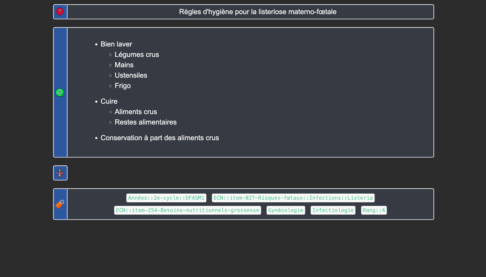
<figcaption>Important : Il faut lire et comprendre les items avant de les apprendre</figcaption>
</figure>
<figure class="carousel-slide">
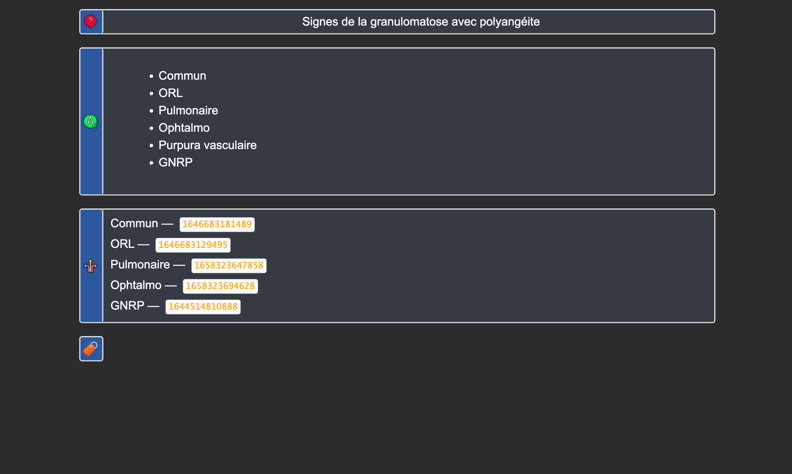
<figcaption>Granulomatose avec polyangéite : une carte sommaire et des cartes liées.</figcaption>
</figure>
<figure class="carousel-slide">
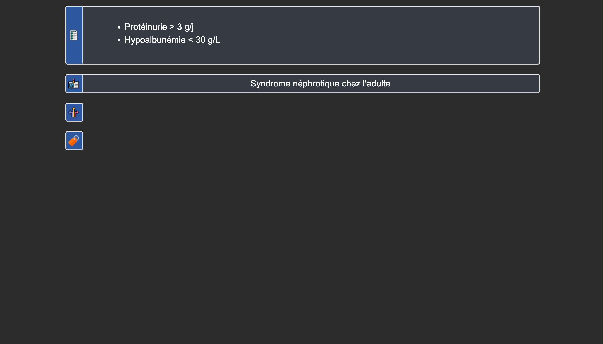
<figcaption>Type de note Syndrome pour s'entraîner à la reconnaissance de pattern.</figcaption>
</figure>
<figure class="carousel-slide">
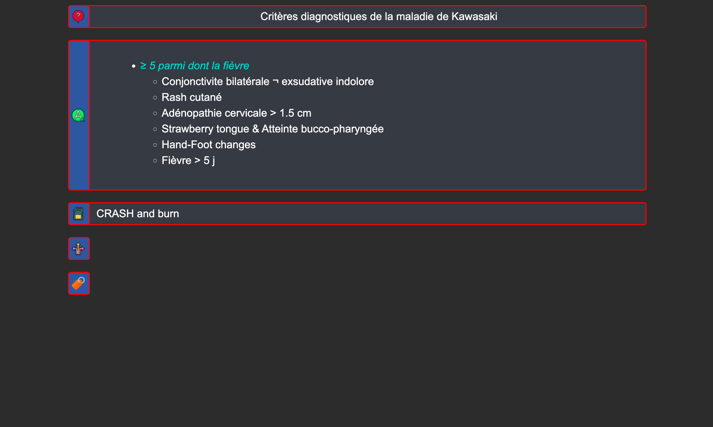
<figcaption>Des mnÉmoniques pour aider à la rétention.</figcaption>
</figure>
<figure class="carousel-slide">
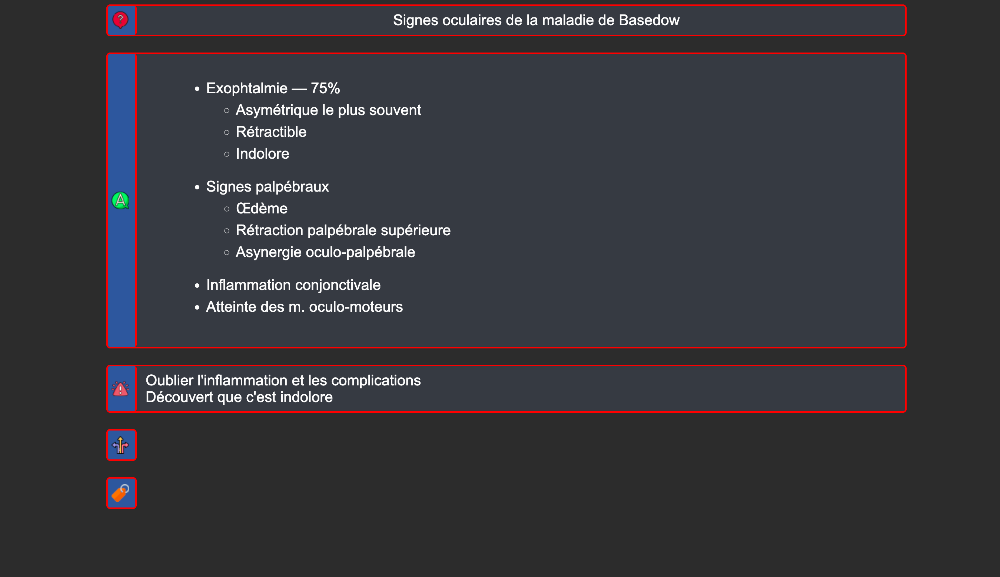
<figcaption>Les cartes difficiles sont mises en évidence.</figcaption>
</figure>
<button class="carousel-btn carousel-next">❯</button>

Pour travailler sur tablette ou téléphone, utilisez les applications **AnkiDroid** / **AnkiMobile** ou **AnkiWeb**. 
> Le support le plus complet reste Anki sur ordinateur, peu importe le système d'exploitation.

Ce paquet se distingue par la brièveté des cartes et par un système de mise en contexte des cartes. Tout cela rend favorable la rétention des informations à très long terme. Rejoignez [Notre Discord](https://discord.gg/2A7zHAEBYt) pour recevoir de l'aide et contribuer au projet.

### "Je n'ai jamais utilisé Anki"
- Jetez un coup d'œil à [ce document](https://drive.google.com/file/d/1UWSg3gj3PyIJq0oXetesZVlbJuRGxLrA/view?usp=drive_link).
- Ensuite [ce drive vous sera utile](https://drive.google.com/drive/u/0/folders/1M9hg4EMRoFRQ4wh_E2xIOu_bKmg7ze59).

## Première installation : Anki, AnkiCollab (téléchargement du deck) et add‑ons
> **Utilisez un ordinateur** (la configuration initiale et les add-ons nécessitent la version PC/Mac)

### 1. Anki 

- [Créez un compte AnkiWeb](https://ankiweb.net/account/signup) ;
- Acceptez "Terms and Conditions" et vérifiez votre mail.
- [Installez Anki sur votre ordinateur](https://apps.ankiweb.net/#downloads) ;
- Une fois sur l'application, appuyez sur synchronisation ou sur la touche <kbd>Y</kbd> puis connectez‑vous à votre compte AnkiWeb ;
- Allez dans `Outils > Greffons > Acquérir des greffons` ou faites <kbd>Ctrl</kbd>+<kbd>Maj</kbd>+<kbd>A</kbd> et collez :

  <code>1957538407 501542723 1052724801 445658251 2135076010 303415230 1906641654 2040501954</code>
  Copié
 On a installé ça[^1].

### 2. AnkiCollab et téléchargement du deck 

- [Créez un compte AnkiCollab](https://www.ankicollab.com/signup) ;
- Relancez Anki, connectez-vous dans `AnkiCollab > Login` ;
- Allez dans `AnkiCollab > Manage Subscriptions` (ou `AnkiCollab > Settings`) :

  <figure style="width: 500px;">
    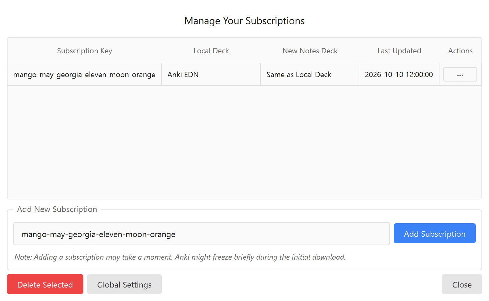
  </figure>

- Dans le champ « Share code: », collez le code de partage puis cliquez sur **Submit** :

  
    <code>mango-may-georgia-eleven-moon-orange</code>
    Copié
  

- Cliquez ensuite sur le bouton **Global Settings** en bas de la fenêtre :

  <figure style="width: 500px;">
    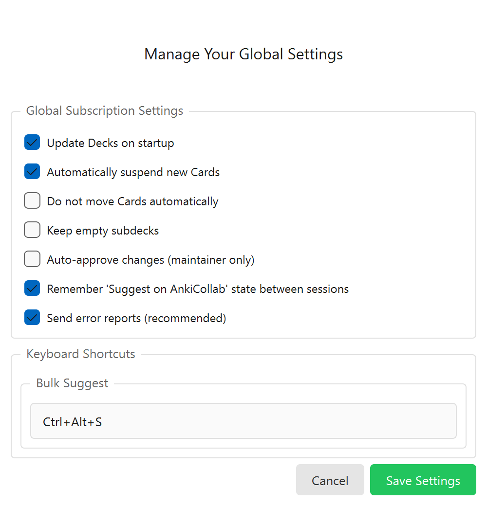
  </figure>

- Cochez les options recommandées :
  - **Update Decks on startup** : pour recevoir automatiquement les mises à jour au lancement d'Anki ;
  - **Automatically suspend new Cards** : pour que les nouvelles cartes soient automatiquement suspendues et ne s'ajoutent pas brutalement à vos révisions quotidiennes ;
  - **Auto-sync on Anki startup and close** et **Synchronize media files when updating decks** ;
- Cliquez sur **Save** : le paquet Anki EDN est maintenant téléchargé et configuré !

### 3. Faire fonctionner Lien entre les cartes (réparation des NID) 

L'add-on Anki EDN NID permet de faire correspondre les identifiants locaux de vos notes pour que la navigation interactive entre les cartes liées fonctionne instantanément.

<figure style="width: 300px;">
  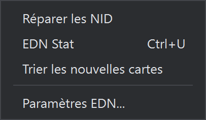
</figure>

1. Dans la barre de menus en haut d'Anki, cliquez sur **Anki EDN** ;
2. Sélectionnez **Réparer les NID** ;
3. L'outil analyse la collection et synchronise les identifiants. Une notification confirme la fin de l'opération ;
4. Vos liens sont maintenant opérationnels sans redémarrage nécessaire.

### 4. Les options de révision  

Nous les optimisons de façon à ce que l'utilisation du paquet ne soit pas trop chronophage. 
- Sur la page d'accueil, rendez‑vous à droite du paquet dans les options (icône d'engrenage à droite du nom du paquet) ;
- En haut, à droite de Sauvegarder cliquez sur `Ajouter un préréglage` et entrez un nom.

#### Paramètres recommandés :
> Astuce : toutes les modifications effectuées par rapport aux réglages par défaut sont signalées.

<figure>
    <figcaption>Paramètres recommandés pour Anki EDN</figcaption>
    
</figure>

- **Nombre maximum de nouvelles cartes par jour** : 50 (c'est le maximum conseillé, il vaut mieux viser 25–40 [^30-40]) ;
- **Nombre maximal de révisions par jour** : illimité (ou 500+) pour ne jamais accumuler de dette cachée ;
- **FSRS** : activé nativement dans Anki (FSRS-6 avec 21 paramètres). Le taux de rétention souhaité recommandé est de **88 % (0.88)** afin de préserver votre temps de travail sur le long cours. 
- **Enfouir les cartes sœurs (Bury Siblings)** : activé pour les nouvelles cartes et les révisions, afin de ne pas voir deux faces ou variantes d'une même note le même jour ;
- **Seuil de pénibilité** : fixé à 20 (les cartes échouées 20 fois sont suspendues pour ne pas monopoliser vos séances) ;
- **Avance automatique** : disponible nativement dans les options pour cadencer vos sessions sans manipulation superflue.

> Lors de la première révision, les espacements entre les révisions sont plus longs qu'avec l'ancien algorithme SM-2, ce qui est normal. Dès votre premier mois de révisions, dans la section `FSRS` des options, cliquez sur `Optimiser`. Répétez l'opération tous les mois !  
Pour en savoir plus sur les paramètres, [référez‑vous à cette vidéo](https://www.youtube.com/watch?v=uo-qQvOZDfg).

## Premier pas avec Anki EDN

Une fois que vous avez installé le paquet, il y a 2 choses à faire en priorité :

1. Jetez un œil à quelques items pour voir si le paquet peut vous convenir :
   - Depuis la page d'accueil d'Anki, allez dans l'explorateur de cartes (cliquez sur Parcourir ou appuyez sur <kbd class="kbd-keyboard">B</kbd>), puis rendez‑vous dans le volet de navigation (à gauche de la page), descendez jusqu'à `Étiquettes` et sous <code>EDN</code> déroulez les étiquettes par items pour juger notre forme de rédaction ([Expliquée ici](#les-normes-du-paquet)). Vous pouvez utiliser `Aperçu` (en haut à droite) pour visualiser les cartes.  

<figure>
    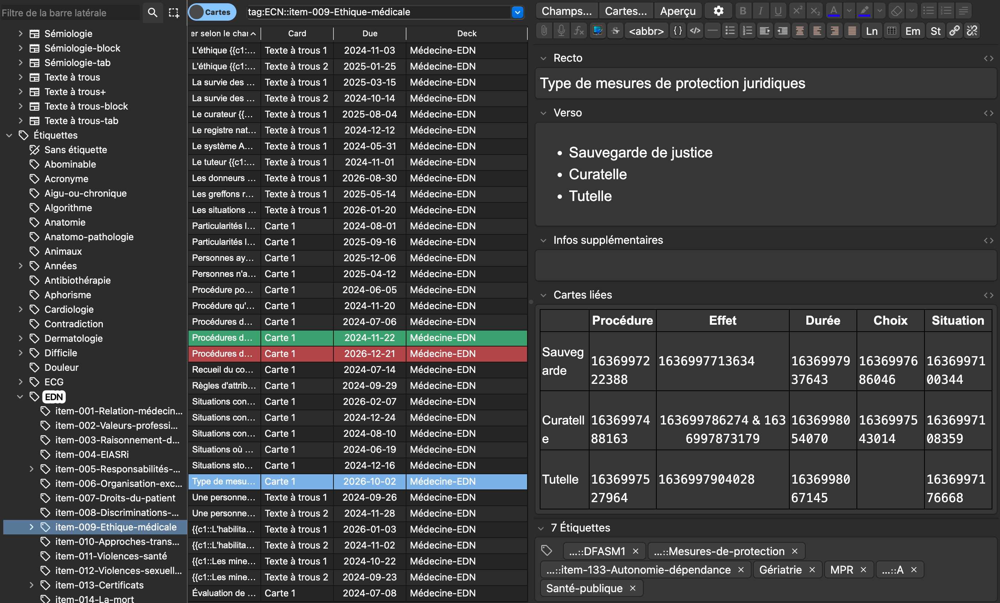
</figure>

2. **Exclure toutes les cartes des révisions (on reviendra là‑dessus)**         
    - Assurez‑vous que l'explorateur est en mode Cartes et pas en mode Notes (en haut et à gauche de la barre de recherche) ;
    - Dans le même volet de navigation (à gauche de l'explorateur), dans `Étiquettes` cliquez sur <code>EDN</code> ;
    - Sélectionnez toutes les cartes via <kbd>Ctrl</kbd>+<kbd>A</kbd> ou <kbd>Cmd</kbd>+<kbd>A</kbd> ;
    - Suspendez les cartes via <kbd>Ctrl</kbd>+<kbd>J</kbd> ou <kbd>Cmd</kbd>+<kbd>J</kbd> ou via un clic droit > <code>Suspendre/Reprendre</code>.

### Réviser un nouvel item

> Avant de commencer à réviser les fiches Anki, il faut avoir une bonne compréhension du cours.  
Sinon, vous serez déroutés par l'ordre aléatoire des cartes.

1. Rendez‑vous dans l'explorateur où vous irez chercher l'étiquette de l'item que vous voulez réviser
    - Allez dans l'explorateur de cartes (cliquez sur Parcourir ou appuyez sur <kbd class="kbd-keyboard">B</kbd>), puis rendez‑vous dans le volet de navigation (à gauche), descendez jusqu'à `Étiquettes` et sous <code>EDN</code> déroulez les items puis cliquez sur celui qui vous intéresse. Vous pouvez alors prendre connaissance des cartes déjà créées avec `Aperçu` (en haut à droite). 
    
2. Désuspendre les cartes que vous souhaitez apprendre   
    - Sélectionnez les cartes qui vous intéressent puis <kbd>Ctrl</kbd>+<kbd>J</kbd> / <kbd>Cmd</kbd>+<kbd>J</kbd> ou via un clic droit > `Suspendre/Reprendre`.

---

## Les abréviations et symboles
C'est un point qui rend plus difficile l'appropriation du paquet.
L'utilisation des symboles permet d'alléger le contenu des cartes et de ne pas les polluer avec des mots de liaison inutiles. On peut alors se concentrer sur le contenu intéressant des cartes.
> Ne vous effrayez pas avec cette liste maintenant. 
> Travaillez avec cette page sous les yeux la première semaine ! On prend vite le coup.

<figure class="embed-figure">
    <!-- Container responsive pour PDF -->
    

        <iframe src="./images/symboles.pdf"></iframe>
    

</figure>

> Vous pouvez **l'imprimer, le mettre en fond d'écran...** 

- Symbole de liaison
  - ~ pour "environ"
  - /| pour "ou"
  - ∨ pour "et/ou" :vee:
  - & pour "et"
  - % pour "par rapport à"
  - α pour "est proportionnel à", "en fonction de", "dépend de" :alpha:
  - // pour "pareil que"
  - ± pour "plus ou moins" :pm:
  - \{*objet*} pour "exclu"
- Symbole autre
  - ↕ ou ‡ pour "arrêt" :ddagger:
  - ›› pour "début" 
  - › pour "puis", "ensuite" ou "en énième intention"
  - ∀ pour "pour tout" ou "tous les" :forall:
  - ∃ pour "il existe" ou "il est possible" :exists:
  - ¬ pour "pas", "non" ou "dans le cas contraire" :neg:
  - Ø pour "non" ou "absence de" :emptyset:
  - ◊ pour "il est possible", "il y a parfois" :nabla:
  - ☐ pour "il faut", "il doit", "il y a toujours" :Xi:
  - ♆ psychiatrique :psi:
- Abréviations
  - svr pour "sévère"
  - ctrl pour "contrôle"
  - R pour "rien", "aucun"
  - sup. pour "superficiel" ou "supérieur"
  - inf. pour "inférieur"
  - lat. pour "latéral"
  - méd. pour "médian" ou "médial"
  - sem. pour "semaine"
  - ATCD pour "antécédent"
  - FdR pour "facteur de risque"
  - vx pour "vaisseau·x"
  - n parmi k pour "combinaison"
  - panpan pour "relation sexuelle"
  - aTDM pour "angio‑TDM" (soit injecté)
  - TMO pour "Traitement Médicamenteux Optimal"
  - PDCB pour "Perte De Conscience Brève"
  - R pour "Rien"
  - ECR pour "Essai Contrôlé Randomisé"
  - ITT pour "Intention de Traiter"
  - Ag pour "Antigène"
  - Ac pour "Anticorps"
- Autres
  - \+ répété <i>n</i> fois pour marquer l'importance (alternativement l'élément principal d'une liste ou l'intensité) de ce qui précède
  - \+ pour "positif"
  - \- pour "négatif"
  - S<i>n</i> pour "à la semaine <i>n</i>"
  - M<i>n</i> pour "au mois <i>n</i>" ou "à l'âge de <i>n</i> mois"
  - A<i>n</i> pour "à l'année <i>n</i>" ou "à l'âge de <i>n</i> ans"

### Rédiger à l'aide des abréviations

  - Pour obtenir les icônes dans votre éditeur :
    - <a href="./assets/raccourcis.csv" download>Télécharger ce fichier</a>
    - Allez dans `Outils > Insert Symbol Options...`

      <figure style="width: 300px;">
        
      </figure>

    - Cliquez sur `Import` et sélectionnez le fichier téléchargé puis `Ok`.
    - Il suffit maintenant d'écrire les commandes directement dans le corps de votre texte pour qu'elles s'insèrent.
    - Les commandes sont visualisables sur [ce tableau](#les-abréviations-et-symboles).

---

## Organisation du Deck
### Les étiquettes

Les cartes sont classées via des étiquettes :

- des étiquettes par items, parfois avec des sous‑tags ;
- des étiquettes par matière ;
- des étiquettes par rang (`Rang::A`, `Rang::B`) ;
- et un certain nombre d'étiquettes thématiques pour faciliter les recherches (`Antibiothérapie`, `Formule`, `Norme`, `Seuil`, `Nom-propre`, entre autres).

<figure>
    
</figure>

### Les drapeaux
> C'est à vous de les placer afin d'optimiser vos révisions

Pour marquer vos cartes durant vos révisions, allez dans `Autres choix > Marqueur de carte` ou utilisez simplement les raccourcis <kbd>Ctrl</kbd>+<kbd>1</kbd> à <kbd>7</kbd> (ou directement <kbd>1</kbd> à <kbd>7</kbd> selon votre configuration).

Voici comment peuvent s'utiliser les drapeaux :

- Rouge pour les cartes qui doivent être modifiées ;
- Orange pour les cartes que vous considérez comme difficiles ;
- Vert pour les cartes importantes ;

### Les paquets

**Il y a un seul paquet 2e cycle.**
Car :
- une carte peut être en rapport avec deux items ;
- une carte ne peut être que dans un paquet à la fois ;
- une carte peut avoir plusieurs étiquettes.

Nous **utilisons donc des étiquettes pour classer vos cartes** et le paquet sert uniquement à **rassembler les cartes à réviser**. Compte tenu des exigences de l'EDN, toutes les cartes sont à réviser de la même façon[^approximation-rang].
#### "Je préfère travailler avec des paquets de matières / d'items"

### Bien réviser
#### Révisions des cartes
- **Difficile** : Usage exceptionnel (réponse juste après un long doute).
- **À revoir** : Si oubli partiel. Les intervalles sont gérés par l'algo, ne trichez pas ! Si une carte gêne, suspendez-la.
- **Facile** : Uniquement pour les évidences.

<figure>
    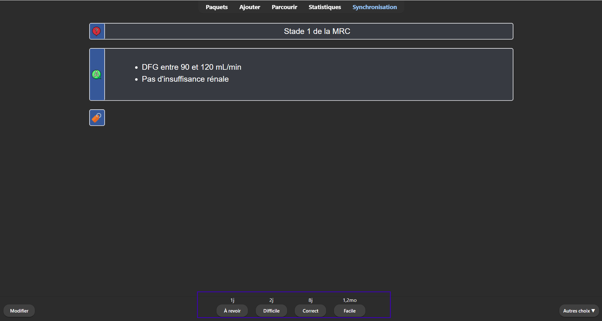
</figure>

#### Autres
- **FSRS** : Optimisez-le une fois par mois (dans les options du paquet > `FSRS > Optimiser`).  
- Faites vos révisions journalières d'une traite si possible.

---

## Proposer une modification
Ce paquet est collaboratif et nous avons besoin de vous pour l'actualiser.

> Les MAJ que vous recevrez sont susceptibles d'ajouter, de supprimer (rarement) ou de modifier des cartes que vous avez déjà apprises. Les modifications faisant partie du programme, vous serez à jour pour le concours.

- Des sauvegardes automatiques sont réalisées nativement par Anki [ici](https://docs.ankiweb.net/files.html#file-locations).
- Si vous voulez protéger des cartes des futures mises à jour qu'elles pourraient subir :
    - Sélectionnez vos cartes à protéger dans l'explorateur, clic droit > `AnkiCollab: Protect fields of note(s)`.

### Notifications

> Après chaque MAJ, des notifications à l'ouverture d'Anki et sur Discord apparaîtront.

#### Après une mise à jour
- Des tags sont généralement créés pour que vous repériez les cartes mises à jour.
- Si la MAJ concerne un item que vous révisez, nous vous conseillons **d'oublier les cartes modifiées que vous aviez apprises**, puis de les réapprendre 
    - Allez dans l'explorateur de cartes (cliquez sur Parcourir ou appuyez sur <kbd class="kbd-keyboard">B</kbd>), puis rendez-vous dans la barre de recherche en haut et au milieu. Tapez <code>tag:</code>. Une autre barre de recherche s'ouvre.
    - Dans cette nouvelle barre de recherche, tapez <code>MAJ</code>.
    - Sélectionnez les cartes qui vous intéressent, puis appuyez sur <kbd>Ctrl</kbd>+<kbd>Alt</kbd>+<kbd>N</kbd> | <kbd>Cmd</kbd>+<kbd>Alt</kbd>+<kbd>N</kbd> ou utilisez le clic droit > `Oublier...`.
    - Si elles ne sont pas suspendues, ces dernières entrent dans la file des "nouvelles cartes".
- Vous pouvez aussi trouver les cartes modifiées ou ajoutées selon la date grâce à l'add‑on BetterSearch.
    - Allez dans Parcourir (<kbd class="kbd-keyboard">B</kbd>), puis dans <code>BetterSearch &gt; Show Date Range Dialog for Edited | Added</code> et lancez la recherche.

#### Après un ajout
- [Les nouvelles cartes sont automatiquement suspendues ;](#2-ankicollab-et-téléchargement-du-deck)
- Les notifications décrivent quels items ont reçu des nouveautés :
    - À vous de désuspendre les cartes 
    - Allez dans l'explorateur de cartes (cliquez sur Parcourir ou appuyez sur <kbd class="kbd-keyboard">B</kbd>), puis rendez-vous dans la barre de recherche en haut et au milieu. Tapez <code>tag:</code>. Une autre barre de recherche s'ouvre.
    - Dans cette nouvelle barre de recherche, tapez <code>NEW</code>.
    - Sélectionnez les cartes qui vous intéressent, puis appuyez sur <kbd>Ctrl</kbd>+<kbd>J</kbd> / <kbd>Cmd</kbd>+<kbd>J</kbd> ou utilisez le clic droit > `Suspendre/Reprendre`.

### Rédiger
Vous pouvez soumettre des modifications pour de multiples raisons, même pour des questions d'ergonomie, de grammaire ou d'esthétique. N'hésitez pas à venir discuter sur le Discord.

> Nous acceptons uniquement les modifications qui tiennent compte des [normes](#les-normes-du-paquet) et des [abréviations](#les-abréviations-et-symboles) du paquet.

> Il faut maîtriser la forme rédactionnelle des cartes.

> Il faut maîtriser l'utilisation de [l'add‑on des liens entre les cartes](https://ankiweb.net/shared/info/445658251) ; vous trouverez un tuto ci‑dessous.

#### Pour rédiger proprement
- Vérifiez que la carte que vous voulez rajouter n'existe pas déjà sous un autre tag.
- Lisez les [normes du deck](#les-normes-du-paquet).
- Respectez l'utilisation des tags :
    - Entrez le(s) item(s) de la carte `EDN::item-*numéro*-*intitulé*`, parfois aussi les sous-tags.
    - Entrez la/les situation(s) de départ de la carte `EDN::ssd-*numéro*-*intitulé*`, parfois aussi les sous-tags.
    - Entrez les tags des matières.
    - Évitez de mélanger les `Rang::A` et les `Rang::B` (le champ `Infos supplémentaires` est votre ami).
    - Entrez les potentiels tags accessoires `Antibiothérapie`, `Score`, ...

- Utilisez les [abréviations](#les-abréviations-et-symboles) du deck.
    - Pour obtenir les icônes dans votre éditeur :
        - <a href="./assets/raccourcis.csv" download>Télécharger ce fichier</a>
        - Allez dans `Outils > Insert Symbol Options...`

          <figure style="width: 400px;">
           
          </figure>

        - Cliquez sur `Import` et sélectionnez le fichier téléchargé puis `Ok`.
    - Il suffit maintenant d'écrire les commandes directement dans le corps de votre texte pour qu'elles s'insèrent.
    - Les commandes sont visualisables sur [ce tableau](#les-abréviations-et-symboles).

<ul style="list-style-type: disc "><li><ul style="list-style-type: circle;"><li><ul style="list-style-type: square;"><li></li></ul></li></ul></li></ul>

- Pour écrire les puces ci‑dessus, utilisez <kbd>Ctrl</kbd>+<kbd>Maj</kbd>+<kbd>.</kbd> | <kbd>Cmd</kbd>+<kbd>Maj</kbd>+<kbd>.</kbd>

#### Pour mettre à jour efficacement un item à l'aide de l'IA
- Nous vous conseillons d'utiliser [Claude](https://claude.ai).
- Allez dans Parcourir (<kbd class="kbd-keyboard">B</kbd>), cherchez les cartes d'intérêt avec <code>tag:</code>, sélectionnez-les avec <kbd>Ctrl</kbd>+<kbd>A</kbd> | <kbd>Cmd</kbd>+<kbd>A</kbd> et exportez-les avec <kbd>Ctrl</kbd>+<kbd>Maj</kbd>+<kbd>E</kbd> | <kbd>Cmd</kbd>+<kbd>Maj</kbd>+<kbd>E</kbd> ou via le menu `Exporter les notes...`.
- De la même manière, vous pouvez exporter les cartes des items en rapport avec l'item d'intérêt.
    - Exportez selon ces réglages.

      <figure style="width: 350px;">
      
      </figure>

- Isolez dans un PDF l'item d'intérêt (des collèges sont disponibles sur le Discord).
- <a href="./assets/Liste_de_Tags_Anki_EDN.txt" download>Ajoutez ce fichier</a>
- Avec ces trois ou quatres pièces jointes, envoyez ce prompt à l'IA :

  <code>Voici mes fiches Anki, le référentiel officiel pour l'item à travailler et une liste des tags et d'abréviations utilisé dans le deck.
Si c'est un item transversal, j'ai ajouté les cartes en rapport avec celui-ci dans le cas où elles n'aurait pas été biens taggés.
Si je t'ai donnés plusieurs pdf référentiel, c'est la dernière édition qui prime (je peux te l'indiquer).
Tu utiliseras comme source uniquement le(s) PDF. S'ils t'apparaissent vide, passe-les par OCR.
Objectif :
Vérifie chaque carte Anki et indique si elle est exacte, à modifier, non sourcée, redondante ou à supprimer.
La forme des cartes est aussi un point d'attention.
Prend garde aux tags et aux rangs des informations. Les rangs C rédigés en couleur verte sur les référentiels sont à ignorer. 
Fait des liens entre les cartes quand nécessaires à l'aide des nID.
Si des notions du référentiel ne sont pas fichées, crée de nouvelles cartes dans mon style habituel.
Analyse en détail les cartes modifiées, supprimées ou ajoutées.	
Utilise le format HTML de mes cartes, la concision et la densité EDN.
Format attendu :
1 Tableau de synthèse
2 Analyse détaillée des cartes modifiées
3 Proposition des nouvelles cartes au format Anki (HTML lisible) avec leurs tags appropriés
4 Signalement des cartes redondantes, sans correspondance ou hors référentiel</code>
  Copié

- Faites les modifications à l'aide des entrées HTML des cartes `<>` (<kbd>Cmd</kbd>+<kbd>Tab</kbd>+<kbd>X</kbd> | <kbd>Ctrl</kbd>+<kbd>Tab</kbd>+<kbd>X</kbd>)

  <figure style="width: 350px;">
      
  </figure>

- Toutes les cartes validées doivent actualiser le tag source (par exemple : `source::2026::ORL`).

#### Pour créer des liens entre les cartes 
- Sélectionnez la note à lier dans l'explorateur ;
- Copiez son identifiant (NID) via `Clic droit > Copy Note ID` ou <kbd>Ctrl</kbd>+<kbd>Maj</kbd>+<kbd>C</kbd> ;
- Dans la note de destination, après avoir collé le NID, sélectionnez-le ou cliquez sur le bouton Lier ou appuyez sur <kbd>Ctrl</kbd>+<kbd>Alt</kbd>+<kbd>L</kbd> ;
- Le lien est créé !
> Plus simple : Dans le champ de la note de destination, cliquez sur le bouton Lier ou appuyez sur <kbd>Ctrl</kbd>+<kbd>Alt</kbd>+<kbd>L</kbd>, cherchez le recto de la carte à lier et insérez-la.

Lorsque vous révisez, passez la souris sur le lien pour afficher un aperçu de la carte liée sans quitter votre révision. Vous pouvez aussi utiliser les raccourcis <kbd>P</kbd>, <kbd>R</kbd> et <kbd>N</kbd> pour naviguer entre les cartes liées.
Vous pouvez cliquer pour éditer la carte aperçu.

### Soumettre

> Que vos ajouts, suppressions ou modifications soient acceptés par la communauté ou non, cela n'impactera pas votre paquet. Vous conserverez vos modifications.

#### Soumettre de nouvelles cartes
- Écrivez vos nouvelles cartes dans la fenêtre principale Ajouter (<kbd>A</kbd>).
- Dans `Type`, sélectionnez le [format qui convient](#types-de-notes) suivi de `-EDN-Picat-x`.
- Dans `Paquet`, sélectionnez `Anki EDN`.
- Renseignez les champs requis et les tags.

##### S'il s'agit d'une seule carte
- Dans la fenêtre d'ajout (Ajouter), cochez la case **Suggest on AnkiCollab** (située à gauche du bouton d'ajout). Lors de la validation, un dialogue s'ouvre pour renseigner un message explicatif et le numéro d'item concerné.

##### S'il s'agit d'un groupe de cartes 
- Dans l'explorateur (Parcourir), sélectionnez les notes concernées, faites un clic droit puis sélectionnez **AnkiCollab: Bulk suggest notes** :

  <figure style="width: 450px;">
      
  </figure>

- Renseignez un message explicatif détaillant les items ou notions concernées.

#### Proposer des modifications
- Modifiez le contenu ou les tags des notes d'intérêt dans l'éditeur.

##### S'il s'agit d'une seule carte 
- Dans l'éditeur de note (en bas de la fenêtre, à côté du champ des étiquettes), cliquez directement sur le bouton **AC: Suggest changes**. Renseignez la motivation de votre correction pour les modérateurs.

##### S'il s'agit d'un groupe de cartes 
- Dans l'explorateur, sélectionnez les notes modifiées, faites un clic droit puis choisissez **AnkiCollab: Bulk suggest notes** et motivez les changements effectués.

#### Supprimer des cartes 
On peut proposer la suppression de cartes si elles sont devenues obsolètes, hors programme ou en doublon.
- Dans l'explorateur (Parcourir), sélectionnez les notes concernées, faites un clic droit puis choisissez **AnkiCollab: Request note removal** :

  <figure style="width: 450px;">
      
  </figure>

- Précisez le motif précis de la demande de retrait.

---

## Les normes du paquet
Ce chapitre explique le format des cartes utilisées et les modes de rédactions des différentes cartes. Pour participer à l'évolution de ce paquet, il faut respecter le mode rédactionnel et intégrer sa logique.

### Flashcards

Les cartes qui composent le paquet ne sont pas des fiches de cours, mais des flashcards.

> 1 carte = 1 info

Par exemple :
Si une prise en charge comprend un traitement pharmacologique, des règles hygiéno-diététiques, et des examens complémentaires de suivi, il y aura probablement 4 cartes : une par pan de la prise en charge et une carte "sommaire" qui demandera de réciter ces 3 grands axes. Des liens cliquables entre les cartes sont construits, ce qui permet une meilleure mise en contexte. Lisez [cette doc](https://ankiweb.net/shared/info/445658251) pour bien l'utiliser.

<figure>
    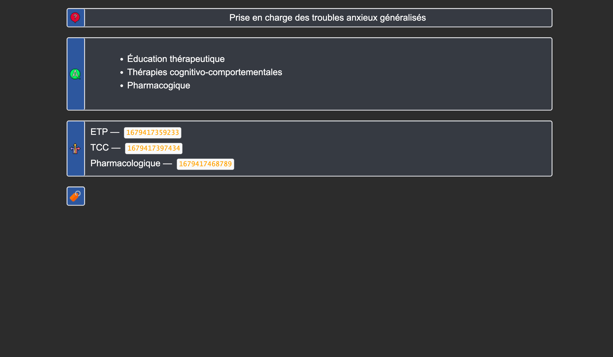
    <figcaption>Les cartes sommaires permettent de ne pas déstructurer l'apprentissage.</figcaption>
</figure>

Les cartes sont donc très courtes, ce qui a 2 conséquences :

- un nombre important de cartes ;
- des cartes rapides à répondre (rarement plus de 10s / cartes)

<figure>
    
    <figcaption>Ici on a une carte sommaire pour la granulomatose avec polyangéite. Les nombreux signes cliniques sont répartis en différentes catégories de telle sorte à ce que chacune des cartes de la série demande de réciter moins de 6-8 signes cliniques.</figcaption>
</figure>

#### Standardisation

Les formulations des cartes sont standardisées : 

- "Examens complémentaires devant <i>X</i>" ;
- "Aspect de <i>X</i> à l'imagerie" ;
- "Prévalence de <i>X</i>" ;
- "Antibiothérapie de <i>X</i>" ;
- etc.

Cela permet de retrouver facilement les cartes dans l'explorateur une fois
que l'on a identifié les formulations récurrentes.

**Les données épidémiologiques sont toujours rapportées sur 100 000 habitant·e·s
de façon à être comparables**, sauf rares exceptions (données en lien avec les
cancers ou quand parler en 1 pour <i>n</i> a du sens). 
> Pour passer d'une valeur
absolue au rapport pour 100 000, il faut simplement multiplier par 660 (en comptant 66 millions d'habitants en France).

### Types de notes

Il y a 5 types de notes principaux :

- **Basique**, avec un Recto et un Verso;
- **Texte à trous**,
- **Sémiologie**, un champ Image, un champ Nom et un
  champ Description. Cela crée 3 cartes : Image → Nom, Nom →
  Description et Description → Nom ;
- **Syndrome**, un champ Nom, et un champ Description. Cela crée 2 cartes : Nom → Description et Description → Nom.

<figure>
    
    <figcaption>Avec le type de note syndrome, on s'entraine à la fois à réciter <b>et</b> reconnaitre un ensemble de signes.</figcaption>
</figure>

### Champs
Certains champs sont auto-explicatifs. Focus sur :
- **Infos supplémentaires** : Illustrations ou infos majeures (bug d'affichage mobile possible).
- **Cartes Liées** : Voir [supra](#flashcards).
- **Mots clés** : Pour la recherche (ex: "SAPL" pour "Syndrome des anti phospholipides"). Parfois placés dans `Comments`.

#### Affichage des cartes difficiles

Les cartes considérées comme difficiles apparaissent différemment pendant les révisions pour pouvoir les repérer et y lire la réponse avec plus d'attention.

<figure>
    
    <figcaption>Un liseré rouge permet d'identifier en un clin d'œil les cartes avec lesquels on a le plus de mal.</figcaption>
</figure>

#### Autre

Il y a des fautes d'accord volontaire sur certaines cartes Texte à trous afin de
ne pas donner trop d'indices lors des révisions.

<figure>
    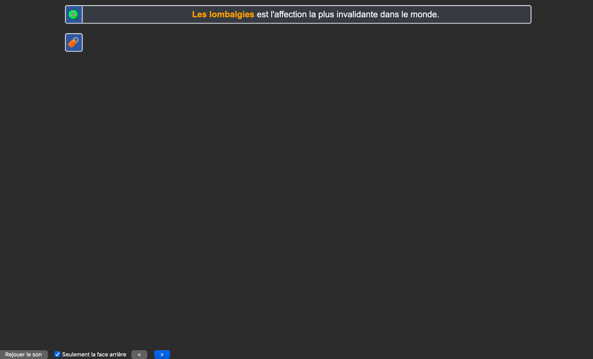
    <figcaption>Si l'accord était respecté, on aurait un indice délétère sur la bonne réponse.</figcaption>
</figure>

#### Droits d'auteur

Tout le contenu du paquet, ainsi que le paquet lui même sont disponibles sous la licence [Creative Commons](https://creativecommons.org/).
Vous pouvez donc partager et modifier les cartes sous 3 conditions :

- vous devez citer Léo Picat et Anki EDN ;
- vous ne pouvez en faire un usage commercial ;
- vous devez les partager sous la même licence.

---

## Mise à jour des Items

[Tableau des MAJ des items](https://docs.google.com/spreadsheets/d/1EpIQmvkDmqrqDy4YTaygqLuE0qrh2Q_t8FdQx6AdEhU/edit?usp=sharing)

  <iframe 
    src="https://docs.google.com/spreadsheets/d/e/2PACX-1vQWeHJNksMrjEWhF6egJk2SjVVYPER7SZumpfqkrPFS6XGlNvX10TU5MvyaQIiWbH1_BlKLm10f0n66/pubhtml?gid=1009852412&amp;single=true&amp;widget=true&amp;headers=false"
    frameborder="0"
    scrolling="yes"
    allowfullscreen>
  </iframe>

---

## FAQ

#### Pourquoi mon paquet affiche 0 carte à réviser après l'installation ?
Par défaut, toutes les cartes du deck sont suspendues afin d'éviter d'accumuler une charge ingérable dès le départ. Consultez la section [Premier pas avec Anki EDN](#premier-pas-avec-anki-edn) pour apprendre à sélectionner et désuspendre les cartes de vos items au fur et à mesure.

#### J'utilisais déjà le paquet de Léo Picat : comment passer sur Anki EDN sans perdre ma progression ?
Le paquet Anki EDN reprend la base du paquet initial en y intégrant les mises à jour collaboratives.
1. Faites une sauvegarde préalable de votre collection (`Fichier > Créer une sauvegarde`).
2. Si vous avez personnalisé certaines cartes déjà apprises, protégez-les avec l'étiquette `AnkiCollab_Protect::All`.
3. Suivez la procédure dans [Première installation](#première-installation--anki-ankicollab-téléchargement-du-deck-et-add-ons). Vos statistiques de révision existantes seront conservées sur les cartes correspondantes.

#### Pourquoi les nouvelles cartes d'un item apparaissent-elles dans le désordre lors de l'apprentissage ?
Dans le paquet principal, Anki présente les nouvelles cartes selon l'ordre général configuré dans vos options. Pour étudier un item spécifique de manière groupée avant de le mélanger au reste :
1. Créez un paquet filtré temporaire en appuyant sur la touche <kbd>F</kbd>.
2. Dans le champ de recherche, entrez : `tag:EDN::item-XXX is:new` (remplacez `XXX` par le numéro de l'item).
3. Cochez l'option *Replanifier les cartes selon mes réponses dans ce paquet*.
4. Une fois votre séance terminée, supprimez le paquet filtré : les cartes retournent automatiquement dans le paquet principal avec leurs nouveaux intervalles FSRS.

#### Puis-je déplacer les cartes dans des sous-paquets permanents par matière ?
Non, c'est déconseillé. AnkiCollab gère les cartes rattachées au paquet unique `Anki EDN`. Si vous déplacez manuellement des cartes dans un autre paquet, toute mise à jour ultérieure les rapatriera automatiquement dans le paquet principal. Pour travailler par matière ou item, privilégiez les paquets filtrés temporaires (<kbd>F</kbd>) décrits dans [Organisation du Deck](#les-paquets).

#### Réviser les items transverses (parasito, pharma...)
Utilisez les étiquettes et l'explorateur : par exemple, la recherche `tag:Infectiologie::Parasites` regroupe l'ensemble des cartes transversales associées.

#### Réviser item par item / par matière
1. Appuyez sur <kbd>F</kbd> (ou `Outils > Créer un paquet filtré`).
2. Dans le champ "Recherche", renseignez vos critères (par exemple : `tag:Cardiologie is:due` ou `tag:EDN::item-155 is:due`).
3. Cochez "Replanifier les cartes selon mes réponses dans ce paquet" puis validez par "Construire".
4. A la fin de votre révision, les cartes réintègrent automatiquement le paquet général "Anki EDN".

#### Que signifient les cartes marquées d'une étoile ?
L'étoile correspond au marqueur natif d'Anki (`tag:marked`, activé par <kbd>Ctrl</kbd>+<kbd>K</kbd> ou <kbd>*</kbd>). Elle ne correspond pas aux annales du concours. Pour hiérarchiser vos cartes, utilisez le système de repérage expliqué dans [Les drapeaux](#les-drapeaux).

#### Prendre une pause (week-end / vacances)
Avec **FSRS Helper**, vous pouvez planifier vos absences sans accumuler de retard :
- **Jours faciles à l'avance** : `Options > FSRS Helper > Jours faciles avec moins de révisions > Appliquer les jours faciles à des dates spécifiques`.
- **La veille du départ** : `Options > FSRS Helper > Schedule a Break` et indiquez la durée de votre interruption.

#### Les ECOS alors ?
Le paquet n'est pas conçu pour la préparation aux ECOS. Les contributions pour développer ce volet sont les bienvenues.

#### Comment fonctionnent les mises à jour et sont-elles automatiques ?
Les modifications validées par les référents sont publiées sur le deck collaboratif. Au démarrage d'Anki sur votre ordinateur connecté à Internet, une notification vous propose d'appliquer la mise à jour.

#### Puis-je recevoir les mises à jour sur mon téléphone (iOS/Android) ?
L'add-on AnkiCollab fonctionne uniquement sur ordinateur. Pour répercuter les nouveautés sur mobile : ouvrez Anki sur votre ordinateur pour récupérer les mises à jour, puis synchronisez avec votre compte AnkiWeb avant d'ouvrir votre application mobile.

#### Faut-il un compte AnkiWeb pour utiliser Anki EDN ?
Un compte AnkiCollab suffit pour un usage sur un poste unique. En revanche, un compte AnkiWeb est indispensable pour synchroniser votre progression entre plusieurs appareils.

#### Mes notifications de mise à jour n'apparaissent pas au démarrage
1. Vérifiez votre connexion dans `AnkiCollab > Login`.
2. Dans `AnkiCollab > Manage Subscriptions > Global Settings` (ou `AnkiCollab > Settings`), assurez-vous que l'option **Update Decks on startup** est bien cochée.

#### Comment vérifier si une mise à jour d'un item a bien été appliquée sur mon deck ?
- Pour visualiser les cartes mises à jour durant un mois précis, cherchez `tag:MAJ::MM/YY` dans l'explorateur (par exemple `tag:MAJ::11/25`).
- Pour voir toutes les cartes modifiées récemment sur votre profil, utilisez le filtre `edited:2` (modifiées ces 2 derniers jours).

#### Vais-je perdre mes modifications personnelles lors des MAJ du deck ?
Si une carte modifiée localement reçoit une mise à jour officielle, son contenu sera synchronisé avec la version collaborative.
- **Protection totale de la note** : appliquez l'étiquette `AnkiCollab_Protect::All`.
- **Protection des étiquettes seules** : appliquez l'étiquette `AnkiCollab_Protect::Tags` (vous recevrez les corrections de texte sans altérer vos classements de tags).
- Le champ *Erreurs faites* est personnel et n'est jamais écrasé.
- Pour des ajouts conséquents de contenu personnel, privilégiez la création de cartes distinctes.

#### Comment restaurer mes modifications personnelles après un incident sans altérer ma planification FSRS ?
1. Créez un profil de secours temporaire (`Fichier > Changer de profil > Ajouter`).
2. Ouvrez dans ce profil une sauvegarde antérieure automatique via le dossier `%appdata%/Anki2/[Profil]/backup/`.
3. Dans l'explorateur du profil de secours, sélectionnez les cartes concernées (`deck:"Anki EDN" -is:suspended`) et exportez-les en `.apkg` en veillant à **décocher** *Inclure les données de planification*.
4. Revenez sur votre profil principal et importez le fichier `.apkg` en sélectionnant l'option *Fusionner les types de notes*. Vos textes personnalisés seront réintégrés sans modifier vos échéances de révision.

#### Que signifie le message indiquant que des cartes ont été supprimées après une synchronisation ?
Ces cartes ont été retirées du deck officiel (obsolescence, doublon ou hors programme). AnkiCollab vous laisse le choix de les supprimer localement ou de les conserver.

#### Pourquoi mes images ne s'affichent pas (icône d'image cassée) ?
Dans le menu en haut, allez dans **AnkiCollab > Check Media** (ou cliquez sur la roue crantée à droite du paquet "Anki EDN" puis sélectionnez **Anki Collab Check Media**).

#### Que faire si les liens entre les cartes renvoient vers une recherche vide ?
1. **Réparation des identifiants** : dans la barre de menus en haut d'Anki, cliquez sur **Anki EDN** puis sélectionnez **Réparer les NID**.
2. **Divergence de profil** : si le problème persiste après réinstallation, consultez les étapes de synchronisation propre dans [Première installation](#3-faire-fonctionner-lien-entre-les-cartes-réparation-des-nid).
3. **Liens non encore créés** : certaines cartes cibles n'ont pas encore été rédigées. Vous pouvez leur attribuer l'étiquette `empty-nid` pour les répertorier.

#### Comment lier deux cartes entre elles dans l'éditeur ?
Copiez le NID de la carte cible, collez-le dans le champ "Cartes Liées", sélectionnez ce NID et cliquez sur le bouton **Lier** (ou <kbd>Ctrl</kbd>+<kbd>Alt</kbd>+<kbd>L</kbd> / <kbd>Option</kbd>+<kbd>Cmd</kbd>+<kbd>L</kbd> sur macOS). Voir les détails dans [Pour créer des liens entre les cartes](#pour-créer-des-liens-entre-les-cartes).

#### Quelles sont les sources de référence utilisées pour les actualisations de cartes ?
Les actualisations reposent sur les **dernières éditions des collèges d'enseignants de spécialités** qui font foi pour le concours, complétées par les fiches LiSA. En cas de contradiction entre deux collèges, la précision est apportée dans le champ *Infos supplémentaires* ou via l'étiquette `source::[Année]::[Spé]`.

#### Que faire si un item n'a aucune carte ou très peu de cartes dans le deck ?
Certains items transversaux spécifiques ne disposent pas encore de cartes complètes. Vous pouvez vérifier dans l'explorateur si les notions ne sont pas déjà couvertes sous d'autres étiquettes, ou proposer de nouvelles fiches en suivant le guide [Proposer une modification](#proposer-une-modification).

---

## Quelques inconvénients

On identifie ces points faibles ci‑dessous :

### Liens morts

Certains liens entre les cartes ne sont pas insérés. C'est principalement le cas quand la création d'une carte aurait relevé d'un micro‑détail.

Par ailleurs, tous les liens pertinents n'ont peut‑être pas été faits.

### Illustrations minimalistes

Certaines cartes manquent d'illustrations ou d'images explicatives. On compte sur vous !

### Erreurs

Il y a sûrement des fautes et des inexactitudes, que ce soit sur la forme ou le contenu. 

Aidez‑nous en remontant les points qui ne semblent pas clairs sur notre [Discord](https://discord.gg/2A7zHAEBYt).

### Le paquet n'est pas une préparation aux ECOS

---

## Remerciements

Ce projet est à l'initiative d'Angelo Marciszewer et est hébergé par la Corporation des Carabins de Sorbonne Université *via* le pôle informatique.

### Nous remercions spécifiquement

- [Léo Picat](https://picat.fr/2024/06/02/paquet-anki-edn.html) pour son deck, son add‑on, sa documentation et surtout sa gentillesse.
- L'équipe d'[AnkiCollab](https://github.com/CravingCrates/AnkiCollab-Plugin/tree/main) et sa communauté.
- [La communauté des externes utilisant Anki](https://www.facebook.com/groups/anki.ecni).

Les icônes sur les cartes viennent de Flaticon et Freepik.

Le Pôle info, spécialement Alexandre, Ragy, Adib, Théo et Rostan.

Matteo et Vladimir !

Merci à Tim pour m'avoir aidé à créer ce site.

Merci à Marion Cohen et Jessica pour le gsheet.

Merci à Mathis Alix pour avoir organisé la coordination de ce projet !

Merci à tous les contributeurs ainsi qu'à leurs relecteurs !

Enfin, merci à tous les étudiants qui nous ont donné des retours.

[^1]: Les greffons installés : 
    - 1957538407 - [AnkiCollab](https://ankiweb.net/shared/info/1957538407) : Pour que AnkiCollab fonctionne !
    - 501542723 - [Auto Sync](https://ankiweb.net/shared/info/501542723) : Pour ne pas perdre votre progression.
    - 445658251 - [Lier les Cartes (Anki EDN)](https://ankiweb.net/shared/info/445658251) : Add‑on inhérent au paquet pour naviguer entre les cartes liées (très important).
    - 2135076010 - [Anki EDN NID](https://ankiweb.net/shared/info/2135076010) : Pour réparer et mettre à jour les identifiants (NID) des cartes liées.
    - 1052724801 - [BetterSearch](https://ankiweb.net/shared/info/1052724801) : Pour naviguer facilement entre les tags (très important).
    - 303415230 - [ReColor Suspended Cards](https://ankiweb.net/shared/info/303415230) : Pour repérer visuellement les cartes suspendues même en mode "Notes" dans l'explorateur.
    - 1906641654 - [See Previous Card Ratings in Reviewer](https://ankiweb.net/shared/info/1906641654) : Pour connaître la difficulté des cartes.
    - 2040501954 - [Symbols As You Type](https://ankiweb.net/shared/info/2040501954) : Pour éditer facilement les cartes.

[^30-40]: Comme la plupart des items ont autour de 50 cartes, on comprend vite que si l'on veut faire plus d'un item par jour, on ne peut pas tout désuspendre.

[^approximation-rang]: Le paquet, se voulant exhaustif, comprend à la fois des connaissances rentables à bien connaître et d'autres, plus anecdotiques. Vous pouvez exclure les cartes que vous jugez non rentables.
