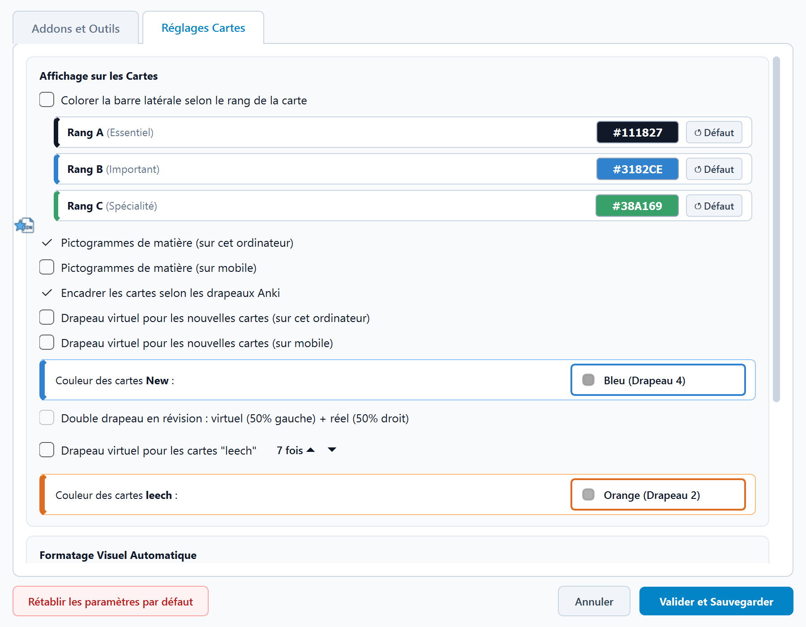

# Anki EDN

  

    ~18 000
    cartes
  

  

    +1 300
    Utilisateurs
  

Anki EDN est un projet qui se base sur le travail et la méthodologie de [Léo Picat](https://picat.fr) (interne en MAR à Paris). Nous voulons rendre son paquet de flashcards collaboratif et communautaire pour le faire perdurer.

Il faut compter **10 minutes** de lecture avant de pouvoir utiliser les cartes Anki de ce **paquet (presque) exhaustif** qui vous mèneront aux EDN. 

<button class="carousel-btn carousel-prev">❮</button>
<figure class="carousel-slide active">

<figcaption>Important : Il faut lire et comprendre les items avant de les apprendre</figcaption>
</figure>
<figure class="carousel-slide">

<figcaption>Granulomatose avec polyangéite : une carte sommaire et des cartes liées.</figcaption>
</figure>
<figure class="carousel-slide">

<figcaption>Type de note Syndrome pour s'entraîner à la reconnaissance de pattern.</figcaption>
</figure>
<figure class="carousel-slide">

<figcaption>Des mnÉmoniques pour aider à la rétention.</figcaption>
</figure>
<figure class="carousel-slide">

<figcaption>Les cartes difficiles sont mises en évidence.</figcaption>
</figure>
<button class="carousel-btn carousel-next">❯</button>

Pour travailler sur tablette ou téléphone, utilisez les applications **AnkiDroid** / **AnkiMobile** ou **AnkiWeb**. 
> Le support le plus complet reste Anki sur ordinateur, peu importe le système d'exploitation.

Ce paquet se distingue par la brièveté des cartes et par un système de mise en contexte des cartes. Tout cela rend favorable la rétention des informations à très long terme. Rejoignez [Notre Discord](https://discord.gg/2A7zHAEBYt) pour recevoir de l'aide et contribuer au projet.

### "Je n'ai jamais utilisé Anki"
- Jetez un coup d'œil à [ce document](https://drive.google.com/file/d/1UWSg3gj3PyIJq0oXetesZVlbJuRGxLrA/view?usp=drive_link).
- Ensuite [ce drive vous sera utile](https://drive.google.com/drive/u/0/folders/1M9hg4EMRoFRQ4wh_E2xIOu_bKmg7ze59).

## Installation d'Anki EDN : l'assistant en 5 étapes

L'installation d'Anki EDN se fait  en **environ 10 minutes**. Installez Anki, et **l'assistant Anki EDN** s'occupe du reste. Il télécharge automatiquement les 8 greffons indispensables[^1], prépare l'abonnement AnkiCollab, applique les préréglages recommandés (FSRS), suspend le paquet pour les nouveaux utilisateurs et répare les liens entre les cartes.

> **Utilisez un ordinateur** (Windows, macOS ou Linux). L'installation initiale, les greffons et les mises à jour collaboratives passent impérativement par la version ordinateur d'Anki. Une fois votre compte synchronisé, vous pourrez réviser librement sur téléphone ou tablette (AnkiMobile, AnkiDroid ou AnkiWeb).
---

<strong>Vous utilisiez déjà le paquet de Léo Picat ?</strong> <em></em>

Vous conservez l'intégralité de votre historique et de votre progression.

1. Si vous avez personnalisé des cartes, ajoutez-leur l'étiquette `AnkiCollab_Protect::All`.
3. **Suivez les étapes 2 à 5** : à l'étape 5, répondez  **Non** à la question « Est-ce votre première utilisation ? ».

---
### 1. Installer Anki 

1. [Créez un compte AnkiWeb](https://ankiweb.net/account/signup), acceptez les conditions d'utilisation et validez l'e-mail de confirmation. Ce compte assure la synchronisation de vos révisions entre vos appareils.
2. [Téléchargez et installez Anki](https://apps.ankiweb.net/#downloads) 
3. Lancez Anki, cliquez sur Synchroniser (ou appuyez sur la touche <kbd>Y</kbd>) et connectez-vous avec votre compte AnkiWeb.

### 2. Installer l'assistant Anki EDN
1. Dans Anki, ouvrez `Outils > Greffons > Acquérir des greffons...` ;
2. Collez le code de l'assistant :

  <code>1167004460</code>
  Copié

3. Validez avec **OK**, puis **fermez Anki et rouvrez-le**.

### 2. **Bienvenue dans Anki EDN**

Au redémarrage d'Anki, l'assistant lance une synchronisation préalable avec AnkiWeb, puis ouvre la fenêtre **Bienvenue dans Anki EDN**.

1. Cliquez sur **Oui** : l'assistant télécharge l'ensemble des greffons nécessaires  (AnkiCollab, Auto Sync, Lier les Cartes, BetterSearch, ReColor Suspended Cards, See Previous Card Ratings, Symbols As You Type) ;
2. Quand la boîte de dialogue **« Les greffons nécessaires ont été installés »** apparaît, **fermez Anki puis rouvrez-le**.

> **Vous avez cliqué sur Non par mégarde ?**  
> Relancez l'assistant à tout moment depuis le menu `Outils > Anki EDN > Lancer / reprendre l'installation`.

### 4. Télécharger le paquet avec AnkiCollab 

1. [Créez un compte AnkiCollab](https://www.ankicollab.com/signup) ;
2. Au redémarrage d'Anki, l'assistant affiche les consignes et copie le code. Cliquez sur **OK** ;
3. Connectez-vous dans `AnkiCollab > Login` ;
4. collez le code de partage dans **Share code:** (<kbd>Ctrl</kbd>+<kbd>V</kbd> / <kbd>Cmd</kbd>+<kbd>V</kbd>) puis cliquez sur **Submit** :

  <code>mango-may-georgia-eleven-moon-orange</code>
  Copié

5. Cliquez sur le bouton **Global Settings** en bas ([capture](./images/ankicollab_manage_subscriptions.png)). Dans la fenêtre **Global Subscription Settings** ([capture](./images/ankicollab_global_settings.png)), cochez :
   - **Update Decks on startup**
   - **Automatically suspend new Cards**
   Laissez les autres options telles quelles et cliquez sur **Save Settings**.
6. Le téléchargement du deck commence.

<figure style="width: 500px;">
  
  <figcaption>Fenêtre Manage Subscriptions d'AnkiCollab avec le bouton Global Settings en bas.</figcaption>
</figure>

<figure style="width: 500px;">
  
  <figcaption>Réglages généraux recommandés pour AnkiCollab.</figcaption>
</figure>

### 5. Finalisation 

1. L'assistant vérifie vos réglages AnkiCollab puis vous demande si c'est votre **première utilisation** du paquet :
   - **Oui** : toutes les cartes sont automatiquement suspendues, afin que vous puissiez les activer progressivement, item par item, au fil de vos cours ;
   - **Non** (ancien utilisateur du deck de Léo Picat) : vos cartes, vos statistiques et votre avancement sont conservés.
2. Il applique automatiquement le préréglage d'options recommandé et active FSRS pour toute la collection (rétention à 88 %) ;
3. Il exécute la **réparation des identifiants (NID)** pour rendre les liens interactifs entre cartes immédiatement opérationnels ;
4. Une notification **Installation terminée** confirme que tout est prêt.

Pour commencer à réviser : ouvrez l'explorateur (Parcourir ou touche <kbd>B</kbd>), dépliez `Étiquettes > EDN`, choisissez un item déjà vu, sélectionnez ses cartes (<kbd>Ctrl</kbd>+<kbd>A</kbd> / <kbd>Cmd</kbd>+<kbd>A</kbd>) et désuspendez-les (<kbd>Ctrl</kbd>+<kbd>J</kbd> / <kbd>Cmd</kbd>+<kbd>J</kbd>).

> **Habitude essentielle** : après votre premier mois de révisions régulières, ouvrez les options du paquet (icône d'engrenage à droite de son nom) et cliquez sur **FSRS > Optimiser**. Répétez ce réglage une fois par mois pour calibrer la planification sur votre propre mémoire.

---

## Recevoir les mises à jour
1. Au démarrage, AnkiCollab télécharge les corrections et nouveaux ajouts validés par les modérateurs.

Pour forcer cette vérification à tout moment : `Outils > Anki EDN > Vérifier les nouveautés du paquet`.

> **Sur téléphone ou tablette** : ouvrez d'abord Anki sur votre ordinateur pour récupérer la mise à jour, synchronisez avec AnkiWeb (<kbd>Y</kbd>), puis ouvrez votre application mobile.

> **Protéger vos modifications personnelles** : ajoutez l'étiquette `AnkiCollab_Protect::All` à une note pour qu'elle ne soit jamais écrasée par une mise à jour, ou `AnkiCollab_Protect::Tags` pour ne protéger que ses étiquettes.

## Ce que l'assistant installe et règle

Cette section récapitule les composants configurés automatiquement par l'assistant. Vous n'avez aucune action manuelle à faire.

### Greffons installés automatiquement

| Code AnkiWeb | Greffon | Rôle |
| :--- | :--- | :--- |
| `1957538407` | [AnkiCollab](https://ankiweb.net/shared/info/1957538407) | Téléchargement et synchronisation collaborative du paquet |
| `501542723` | [Auto Sync](https://ankiweb.net/shared/info/501542723) | Synchronisation automatique en arrière-plan avec AnkiWeb |
| `445658251` | [Lier les Cartes (Anki EDN)](https://ankiweb.net/shared/info/445658251) | Navigation interactive entre cartes liées et prévisualisation |
| `2135076010` | [Anki EDN NID](https://ankiweb.net/shared/info/2135076010) | Réparation des identifiants des cartes liées sans toucher au FSRS |
| `1052724801` | [BetterSearch](https://ankiweb.net/shared/info/1052724801) | Recherche rapide dans les étiquettes et filtrage temporel |
| `303415230` | [ReColor Suspended Cards](https://ankiweb.net/shared/info/303415230) | Repérage visuel immédiat des cartes suspendues |
| `1906641654` | [See Previous Card Ratings in Reviewer](https://ankiweb.net/shared/info/1906641654) | Historique de difficulté et de réponses lors des révisions |
| `2040501954` | [Symbols As You Type](https://ankiweb.net/shared/info/2040501954) | Saisie rapide des symboles et abréviations médicales |

### Préréglage d'options « Anki EDN » 

<figure>
  <figcaption>Paramètres recommandés pour Anki EDN</figcaption>
  
</figure>

| Réglage | Valeur appliquée | Justification |
| --- | --- | --- |
| Nouvelles cartes par jour | **50** | Plafond de sécurité. Il est conseillé de viser 25 à 40 nouvelles cartes par jour [^30-40]. |
| Révisions par jour | **9999** (illimité) | Pour ne jamais accumuler de dette cachée de cartes dues. |
| Algorithme FSRS | **Activé** | FSRS-6 avec calcul personnalisé des intervalles de mémoire. |
| Rétention souhaitée | **0,88 (88 %)** | Équilibre idéal entre volume quotidien de révision et rétention durable sur les 2 à 3 années de préparation. |
| Enfouir les cartes sœurs | **Activé** (nouvelles et révisions) | Évite de voir deux variantes d'une même notion le même jour. |
| Seuil de pénibilité (Leech) | **12**, action : suspendre | Suspend les cartes échouées 12 fois pour ne pas monopoliser les séances. |

> Vous pouvez modifier ces options à tout moment dans les paramètres du paquet (engrenage à droite de son nom). Pour les réappliquer automatiquement : `Outils > Anki EDN > Lancer / reprendre l'installation` ; vos cartes ne sont jamais resuspendues.

---

### Personnalisation et Paramètres EDN

Le menu **Anki EDN > Paramètres EDN...** regroupe l'ensemble des réglages avancés de la suite en trois onglets :

<figure style="width: 500px;">
  
  <figcaption>Fenêtre de personnalisation des cartes et fonctionnalités Anki EDN.</figcaption>
</figure>

- **Addons et Outils** :
  - **Gestionnaire de greffons** : activation/désactivation et réinstallation en un clic des greffons indispensables et recommandés, avec raccourci **Importer symboles** (`raccourcis.csv`) et accès direct aux **Raccourcis clavier** ;
  - **Gestion multi-fenêtres** : autorise l'ouverture simultanée de plusieurs fenêtres `Parcourir` (explorateur) et `Ajouter` ;
  - **Protection automatique des champs (AnkiCollab)** : détecte les champs que vous modifiez personnellement et leur appose automatiquement le tag `AnkiCollab_Protect::<Champ>` avant synchronisation (bouton **Protéger maintenant** pour un scan immédiat) ; Vous restez isolé des modifications apportées par la communauté pour ces cartes.
  - **Rappel d'optimisation FSRS** : rappel périodique configurable pour optimiser vos paramètres FSRS ;
  - **Éditeur** : insertion automatique d'une liste à puces à l'entrée dans les champs `Verso` ou `Description` vides.
- **Réglages Cartes** :
  - **Barre de couleur selon le rang**
  - **Pictogrammes de spécialité**
  - **Encadrement par drapeau et drapeaux virtuels** : bordure colorée selon les drapeaux Anki **drapeau virtuel sur les nouvelles cartes** en 1re révision (sur PC et/ou mobile, sans modifier le vrai drapeau Anki), **double drapeau** (moitié gauche virtuelle / moitié droite réelle) et **drapeau virtuel Leech** automatique après `N` échecs (`À revoir`, défaut : 7) ;
  - **Formatage visuel automatique** : fusion des sauts de ligne consécutifs, retour à la ligne après chaque carte liée, majuscule automatique en début de ligne/carte liée et nettoyage des couleurs parasites au copier-coller.
- **Lier les cartes** :
  - **Lien miroir automatique (`A ↔ B`)** lors du collage d'un NID, **description contextuelle intelligente** pré-remplie, **suggestions de liens** en direct et mot-clé déclencheur (`nid:`) ;
  - **Miniature au survol** : affichage des drapeaux virtuels  et masquage à la carte des sections secondaires (`Sources`, `Commentaires`, `Tags`, `Cartes Liées`, `Erreurs faites`, `Mnémotechniques`, `Infos supplémentaires`).

---

## Dépannage

| Problème rencontré | Solution |
| --- | --- |
| Conflit entre l'ordinateur et AnkiWeb lors de la synchronisation | Choisissez **Télécharger depuis AnkiWeb** si votre compte contient déjà des révisions, ou **Envoyer vers AnkiWeb** s'il est neuf ou vide (voir étape 3). |
| La fenêtre de bienvenue de l'assistant ne s'affiche pas | Allez dans `Outils > Anki EDN > Lancer / reprendre l'installation`. |
| La fenêtre AnkiCollab ne s'est pas ouverte automatiquement | Ouvrez `AnkiCollab > Manage Subscriptions` et collez le code `mango-may-georgia-eleven-moon-orange`. |
| La finalisation ne démarre pas après la fin du téléchargement | Fermez puis rouvrez Anki : l'assistant reprend automatiquement là où il s'était arrêté. |
| Le paquet affiche 0 carte à réviser après l'installation | C'est normal : par défaut toutes les cartes sont suspendues pour ne pas vous noyer. Désuspendez les cartes des items que vous étudiez (étape 5). |
| Les liens entre cartes renvoient vers une recherche vide | Allez dans le menu `Anki EDN > Réparer les NID`. |
| Images cassées sur les cartes | Ouvrez `AnkiCollab > Check Media` dans le menu en haut. |
| Aucune proposition de mise à jour au démarrage | Vérifiez que vous êtes connecté (`AnkiCollab > Login`) et que l'option **Update Decks on startup** est bien cochée dans `AnkiCollab > Manage Subscriptions > Global Settings`. |

<b>Installation manuelle de secours</b>

Si l'assistant ne peut pas s'exécuter sur votre configuration, l'installation manuelle reste possible :
1. Dans Anki, ouvrez `Outils > Greffons > Acquérir des greffons...` (<kbd>Ctrl</kbd>+<kbd>Maj</kbd>+<kbd>A</kbd>) et collez l'ensemble des codes suivants :

  <code>1957538407 501542723 1052724801 445658251 2135076010 303415230 1906641654 2040501954</code>
  Copié

2. Redémarrez Anki, connectez-vous dans `AnkiCollab > Login`, puis ouvrez `AnkiCollab > Manage Subscriptions` ;
3. Cliquez sur **Global Settings**, cochez **Update Decks on startup** et **Automatically suspend new Cards**, puis enregistrez ;
4. Collez le code de partage `mango-may-georgia-eleven-moon-orange` et cliquez sur **Submit** ;
5. Une fois le paquet téléchargé, appliquez les préréglage d'options recommandé et réparez les NID via le menu `Anki EDN > Paramètres > Réparer les NID`.

Besoin d'aide ? Rejoignez [le Discord Anki EDN](https://discord.gg/2A7zHAEBYt) pour échanger avec l'équipe et les autres étudiants.

## Réviser un nouvel item

> Avant de commencer à réviser les fiches Anki, il faut avoir une bonne compréhension de l'item.  
Sinon, vous serez déroutés par l'ordre aléatoire des cartes.

1. Rendez‑vous dans l'explorateur où vous irez chercher l'étiquette de l'item que vous voulez réviser
    - Allez dans l'explorateur de cartes (cliquez sur Parcourir ou appuyez sur <kbd class="kbd-keyboard">B</kbd>), puis rendez‑vous dans le volet de navigation (à gauche), descendez jusqu'à `Étiquettes` et sous <code>EDN</code> déroulez les items puis cliquez sur celui qui vous intéresse. Vous pouvez alors prendre connaissance des cartes déjà créées avec `Aperçu` (en haut à droite). 
    
2. Désuspendre les cartes que vous souhaitez apprendre   
    - Sélectionnez les cartes qui vous intéressent puis <kbd>Ctrl</kbd>+<kbd>J</kbd> / <kbd>Cmd</kbd>+<kbd>J</kbd> ou via un clic droit > `Suspendre/Reprendre`.

---

## Les abréviations et symboles
C'est un point qui rend plus difficile l'appropriation du paquet.
L'utilisation des symboles permet d'alléger le contenu des cartes. 
> Travaillez avec cette page sous les yeux la première semaine ! On prend vite le coup.

<figure class="embed-figure">
    <!-- Container responsive pour PDF -->
    

        <iframe src="./images/symboles.pdf"></iframe>
    

</figure>

> Vous pouvez **l'imprimer, le mettre en fond d'écran...** 

- Symbole de liaison
  - ~ pour "environ"
  - /| pour "ou"
  - ∨ pour "et/ou" :vee:
  - & pour "et"
  - % pour "par rapport à"
  - α pour "est proportionnel à", "en fonction de", "dépend de" :alpha:
  - // pour "pareil que"
  - ± pour "plus ou moins" :pm:
  - \{*objet*} pour "exclu"
- Symbole autre
  - ↕ ou ‡ pour "arrêt" :ddagger:
  - ›› pour "début" 
  - › pour "puis", "ensuite" ou "en énième intention"
  - ∀ pour "pour tout" ou "tous les" :forall:
  - ∃ pour "il existe" ou "il est possible" :exists:
  - ¬ pour "pas", "non" ou "dans le cas contraire" :neg:
  - Ø pour "non" ou "absence de" :emptyset:
  - ◊ pour "il est possible", "il y a parfois" :nabla:
  - ☐ pour "il faut", "il doit", "il y a toujours" :Xi:
  - ♆ psychiatrique :psi:
- Abréviations
  - svr pour "sévère"
  - ctrl pour "contrôle"
  - R pour "rien", "aucun"
  - sup. pour "superficiel" ou "supérieur"
  - inf. pour "inférieur"
  - lat. pour "latéral"
  - méd. pour "médian" ou "médial"
  - sem. pour "semaine"
  - ATCD pour "antécédent"
  - FdR pour "facteur de risque"
  - vx pour "vaisseau·x"
  - n parmi k pour "combinaison"
  - panpan pour "relation sexuelle"
  - aTDM pour "angio‑TDM" (soit injecté)
  - TMO pour "Traitement Médicamenteux Optimal"
  - PDCB pour "Perte De Conscience Brève"
  - R pour "Rien"
  - ECR pour "Essai Contrôlé Randomisé"
  - ITT pour "Intention de Traiter"
  - Ag pour "Antigène"
  - Ac pour "Anticorps"
- Autres
  - \+ répété <i>n</i> fois pour marquer l'importance (alternativement l'élément principal d'une liste ou l'intensité) de ce qui précède
  - \+ pour "positif"
  - \- pour "négatif"
  - S<i>n</i> pour "à la semaine <i>n</i>"
  - M<i>n</i> pour "au mois <i>n</i>" ou "à l'âge de <i>n</i> mois"
  - A<i>n</i> pour "à l'année <i>n</i>" ou "à l'âge de <i>n</i> ans"

### Rédiger à l'aide des abréviations

L'assistant de configuration installe automatiquement le greffon **Symbols As You Type** (code `2040501954`). Pour charger la liste des abréviations médicales du paquet, il suffit d'importer une fois le fichier de configuration :

1. <a href="./assets/raccourcis.csv" download>Téléchargez le fichier raccourcis.csv</a> ;
2. Dans Anki, ouvrez le menu `Outils > Insert Symbol Options...` ;
3. Cliquez sur le bouton `Import`, sélectionnez le fichier `raccourcis.csv` téléchargé puis validez.

<figure style="width: 300px;">
  
</figure>

Une fois importé, écrivez simplement la commande dans l'éditeur de carte (ex. `:p` pour ⚠️, `=>` pour →) pour insérer le symbole instantanément. L'ensemble des correspondances est listé dans [ce tableau](#les-abréviations-et-symboles).

---

## Organisation du Deck
### Les étiquettes

Les cartes sont classées via des étiquettes :

- des étiquettes par items, parfois avec des sous‑tags ;
- des étiquettes par matière ;
- des étiquettes par rang (`Rang::A`, `Rang::B`) ;
- et un certain nombre d'étiquettes thématiques pour faciliter les recherches (`Antibiothérapie`, `Formule`, `Norme`, `Seuil`, `Nom-propre`, entre autres).

<figure>
    
</figure>

### Les drapeaux
> C'est à vous de les placer afin d'optimiser vos révisions

Pour marquer vos cartes durant vos révisions, allez dans `Autres choix > Marqueur de carte` ou utilisez simplement les raccourcis <kbd>Ctrl</kbd>+<kbd>1</kbd> à <kbd>7</kbd> (ou directement <kbd>1</kbd> à <kbd>7</kbd> selon votre configuration).

Voici comment peuvent s'utiliser les drapeaux :

- Rouge pour les cartes qui doivent être modifiées ;
- Orange pour les cartes que vous considérez comme difficiles ;
- Vert pour les cartes importantes ;

### Les paquets

**Il y a un seul paquet 2e cycle.**
Car :
- une carte peut être en rapport avec deux items ;
- une carte ne peut être que dans un paquet à la fois ;
- une carte peut avoir plusieurs étiquettes.

Nous **utilisons donc des étiquettes pour classer vos cartes** et le paquet sert uniquement à **rassembler les cartes à réviser**. Compte tenu des exigences de l'EDN, toutes les cartes sont à réviser de la même façon[^approximation-rang].
#### "Je préfère travailler avec des paquets de matières / d'items"

Ne déplacez jamais les cartes hors du paquet `Anki EDN` (cela casserait la synchronisation AnkiCollab). Utilisez le **Générateur de paquets filtrés hiérarchiques** intégré :

- Ouvrez `Anki EDN > Générateur de paquets filtrés...`
- **Arborescence sur mesure (`EDN - Paquets Filtrés`)** : cochez les spécialités, les items ou les sous-volets d'items que vous souhaitez étudier.

### Bien réviser
#### Révisions des cartes
- **Difficile** : Usage exceptionnel (réponse juste après un long doute).
- **À revoir** : Si oubli partiel. Les intervalles sont gérés par l'algo, ne trichez pas ! Si une carte gêne, suspendez-la.
- **Facile** : Uniquement pour les évidences.
- **Enfouir** : Permet de pousser la révision de la carte au lendemain. Meta si il vous manquait qu'un détail ou si vous avez fait une fausse manip.

<figure>
    
</figure>

#### Autres
- **FSRS** : Optimisez-le une fois par mois (dans les options du paquet > `FSRS > Optimiser`).  
- Faites vos révisions journalières d'une traite si possible.
- Cliquez sur n'importe quel tag affiché au bas de la carte pour lancer sa recherche dans l'explorateur.
- **Édition rapide des tags en révision** : appuyez sur <kbd>T</kbd> (ou <kbd>Maj</kbd>+<kbd>T</kbd>) pendant vos révisions pour ajouter ou retirer des étiquettes.
- **Suivi de progression (`EDN Stat`)** : appuyez sur <kbd>Ctrl</kbd>+<kbd>U</kbd> (ou `Anki EDN > EDN Stat`) pour visualiser votre avancement par items.

---

## Proposer une modification
Ce paquet est collaboratif et nous avons besoin de vous pour l'actualiser.

> Les MAJ que vous recevrez sont susceptibles d'ajouter, de supprimer (rarement) ou de modifier des cartes que vous avez déjà apprises. Les modifications faisant partie du programme, vous serez à jour pour le concours.

- Des sauvegardes automatiques sont réalisées nativement par Anki [ici](https://docs.ankiweb.net/files.html#file-locations).
- **Protection automatique et manuelle de vos champs personnels** :
    - Le champ `Erreurs faites` est strictement personnel et n'est jamais écrasé lors des mises à jour.
    - Lorsque l'option **Protéger automatiquement les champs modifiés** est activée dans `Anki EDN > Paramètres EDN...`, tout champ que vous éditez localement reçoit automatiquement l'étiquette `AnkiCollab_Protect::<Nom_du_champ>` avant la synchronisation.
    - Pour protéger manuellement une note ou des champs spécifiques : sélectionnez les notes dans l'explorateur, faites un clic droit > `AnkiCollab: Protect fields of note(s)`.
- **Revue visuelle des mises à jour (greffon optionnel `Diff Hunk` — code `132168060`)** :
    - Intercepte dans un bac à sable les synchronisations AnkiCollab et les imports `.apkg`/`.colpkg`/`.csv` portant sur vos cartes déjà apprises.
    - Affiche les différences mot à mot et les évolutions de tags : acceptez ou rejetez chaque bloc (`[+]`/`[−]`, <kbd>Tab</kbd> pour naviguer, <kbd>Y</kbd>/<kbd>N</kbd> ou <kbd>Espace</kbd> pour basculer, <kbd>F2</kbd>/<kbd>Alt</kbd>+<kbd>A</kbd> tout accepter, <kbd>F3</kbd>/<kbd>Alt</kbd>+<kbd>R</kbd> tout rejeter, <kbd>F4</kbd> accepter les tags seuls) ou fusionnez le texte manuellement.
    - Accessible aussi à tout moment dans le panneau latéral de l'explorateur (`Diff Hunk`, `Old Fields`, `History & Collab`, raccourcis <kbd>Alt</kbd>+<kbd>H</kbd> et <kbd>Alt</kbd>+<kbd>C</kbd>).

### Notifications

> Après chaque MAJ, des notifications à l'ouverture d'Anki et sur Discord apparaîtront.

#### Après une mise à jour
- Des tags sont généralement créés pour que vous repériez les cartes mises à jour.
- Si la MAJ concerne un item que vous révisez, nous vous conseillons **d'oublier les cartes modifiées que vous aviez apprises**, puis de les réapprendre 
    - Allez dans l'explorateur de cartes (cliquez sur Parcourir ou appuyez sur <kbd class="kbd-keyboard">B</kbd>), puis rendez-vous dans la barre de recherche en haut et au milieu. Tapez <code>tag:</code>. Une autre barre de recherche s'ouvre.
    - Dans cette nouvelle barre de recherche, tapez <code>MAJ</code>.
    - Sélectionnez les cartes qui vous intéressent, puis appuyez sur <kbd>Ctrl</kbd>+<kbd>Alt</kbd>+<kbd>N</kbd> | <kbd>Cmd</kbd>+<kbd>Alt</kbd>+<kbd>N</kbd> ou utilisez le clic droit > `Oublier...`.
    - Si elles ne sont pas suspendues, ces dernières entrent dans la file des "nouvelles cartes".
- Vous pouvez aussi trouver les cartes modifiées ou ajoutées selon la date grâce à l'add‑on BetterSearch.
    - Allez dans Parcourir (<kbd class="kbd-keyboard">B</kbd>), puis dans <code>BetterSearch &gt; Show Date Range Dialog for Edited | Added</code> et lancez la recherche.

### Rédiger
Vous pouvez soumettre des modifications pour de multiples raisons, même pour des questions d'ergonomie, de grammaire ou d'esthétique. N'hésitez pas à venir discuter sur le Discord.

> Nous acceptons uniquement les modifications qui tiennent compte des [normes](#les-normes-du-paquet) et des [abréviations](#les-abréviations-et-symboles) du paquet.

> Il faut maîtriser la forme rédactionnelle des cartes.

> Il faut maîtriser l'utilisation de [l'add‑on des liens entre les cartes](https://ankiweb.net/shared/info/445658251) ; vous trouverez un tuto ci‑dessous.

#### Pour rédiger proprement
- Vérifiez que la carte que vous voulez rajouter n'existe pas déjà sous un autre tag.
- Lisez les [normes du deck](#les-normes-du-paquet).
- Respectez l'utilisation des tags :
    - Entrez le(s) item(s) de la carte `EDN::item-*numéro*-*intitulé*`
    - Entrez la/les situation(s) de départ de la carte `EDN::ssd-*numéro*-*intitulé*` (ou `EDN::SDD::*`)
    - Entrez l'objectif LiSA correspondant si applicable (`OIC::XXX-YY-R`).
    - Entrez les tags des matières.
    - Évitez de mélanger les `Rang::A` et les `Rang::B` (le champ `Infos supplémentaires` est votre ami).
    - Renseignez le référentiel source (`source::AAAA::Collège`, ex. `source::2024::ORL`)
    - Entrez les potentiels tags accessoires `Antibiothérapie`, `Score`, `Formule`, `Norme`, `Seuil`, `Nom-propre`
- Utilisez les [abréviations](#les-abréviations-et-symboles) du deck.

<ul style="list-style-type: disc "><li><ul style="list-style-type: circle;"><li><ul style="list-style-type: square;"><li></li></ul></li></ul></li></ul>

- Pour écrire les puces ci‑dessus, utilisez <kbd>Ctrl</kbd>+<kbd>Maj</kbd>+<kbd>.</kbd> | <kbd>Cmd</kbd>+<kbd>Maj</kbd>+<kbd>.</kbd>

#### Pour créer des liens entre les cartes 
- **Par recherche directe dans l'éditeur** : placez le curseur dans le champ souhaité (notamment `Cartes liées`), cliquez sur le bouton Lier, appuyez sur <kbd>Ctrl</kbd>+<kbd>Alt</kbd>+<kbd>L</kbd> ou tapez `nid:`, puis recherchez la note cible.
- **Par copie d'identifiant (NID)** : dans l'explorateur, copiez l'identifiant d'une note via <kbd>Ctrl</kbd>+<kbd>Alt</kbd>+<kbd>C</kbd> (ou <kbd>Ctrl</kbd>+<kbd>Maj</kbd>+<kbd>C</kbd> / `Clic droit > Copy Note ID`), collez-le dans la note de destination et appuyez sur <kbd>Ctrl</kbd>+<kbd>Alt</kbd>+<kbd>L</kbd>.
- **Lien miroir et assistant latéral** : le collage d'un NID peut créer automatiquement le lien réciproque (`A ↔ B`) avec une description contextuelle pré-remplie. Le volet latéral **Assistant de Liens** de l'éditeur affiche en direct les liens entrants, sortants, réciproques et les suggestions de cartes proches.

Lorsque vous révisez :
- Passez la souris sur un lien pour afficher sa **miniature d'aperçu** ;  faites un **clic droit > Learn Now** pour réviser immédiatement la carte liée.
- Utilisez les raccourcis clavier : <kbd>P</kbd> (aperçu du lien), <kbd>N</kbd> (lien suivant), <kbd>R</kbd> (ouvrir dans l'explorateur), <kbd>Z</kbd> (revenir à la carte source) et <kbd>Ctrl</kbd>+<kbd>Alt</kbd>+<kbd>B</kbd> (ouvrir l'assistant de liens).

### Soumettre

> Que vos ajouts, suppressions ou modifications soient acceptés par la communauté ou non, cela n'impactera pas votre paquet. Vous conserverez vos modifications.

#### Soumettre de nouvelles cartes
- Écrivez vos nouvelles cartes dans la fenêtre principale Ajouter (<kbd>A</kbd>).
- Dans `Type`, sélectionnez le [format qui convient](#types-de-notes) suivi de `-EDN-Picat-x`.
- Dans `Paquet`, sélectionnez `Anki EDN`.
- Renseignez les champs requis et les tags.

##### S'il s'agit d'une seule carte
- Dans la fenêtre d'ajout (Ajouter), cochez la case **Suggest on AnkiCollab** (située à gauche du bouton d'ajout). Lors de la validation, un dialogue s'ouvre pour renseigner un message explicatif et le numéro d'item concerné.

##### S'il s'agit d'un groupe de cartes 
- Dans l'explorateur (Parcourir), sélectionnez les notes concernées, faites un clic droit puis sélectionnez **AnkiCollab: Bulk suggest notes** :

  <figure style="width: 450px;">
      
  </figure>

- Renseignez un message explicatif détaillant les items ou notions concernées.

#### Proposer des modifications
- Modifiez le contenu ou les tags des notes d'intérêt dans l'éditeur.

##### S'il s'agit d'une seule carte 
- Dans l'éditeur de note (en bas de la fenêtre, à côté du champ des étiquettes), cliquez directement sur le bouton **AC: Suggest changes**. Renseignez la motivation de votre correction pour les modérateurs.

##### S'il s'agit d'un groupe de cartes 
- Dans l'explorateur, sélectionnez les notes modifiées, faites un clic droit puis choisissez **AnkiCollab: Bulk suggest notes** et motivez les changements effectués.

#### Supprimer des cartes 
On peut proposer la suppression de cartes si elles sont devenues obsolètes, hors programme ou en doublon.
- Dans l'explorateur (Parcourir), sélectionnez les notes concernées, faites un clic droit puis choisissez **AnkiCollab: Request note removal** :

  <figure style="width: 450px;">
      
  </figure>

- Précisez le motif précis de la demande de retrait.

<b>Pour mettre à jour efficacement un item à l'aide de l'IA</b>

- Nous vous conseillons d'utiliser [Claude](https://claude.ai).
- Allez dans Parcourir (<kbd class="kbd-keyboard">B</kbd>), cherchez les cartes d'intérêt avec <code>tag:</code>, sélectionnez-les avec <kbd>Ctrl</kbd>+<kbd>A</kbd> | <kbd>Cmd</kbd>+<kbd>A</kbd> et exportez-les avec <kbd>Ctrl</kbd>+<kbd>Maj</kbd>+<kbd>E</kbd> | <kbd>Cmd</kbd>+<kbd>Maj</kbd>+<kbd>E</kbd> ou via le menu `Exporter les notes...`.
- De la même manière, vous pouvez exporter les cartes des items en rapport avec l'item d'intérêt.
    - Exportez selon ces réglages.

      <figure style="width: 350px;">
      
      </figure>

- Isolez dans un PDF l'item d'intérêt.
- <a href="./assets/Liste_de_Tags_Anki_EDN.txt" download>Ajoutez ce fichier</a>
- Avec ces trois ou quatres pièces jointes, envoyez ce prompt à l'IA :

  <code>Voici mes fiches Anki, le référentiel officiel pour l'item à travailler et une liste des tags et d'abréviations utilisé dans le deck.
Si c'est un item transversal, j'ai ajouté les cartes en rapport avec celui-ci dans le cas où elles n'aurait pas été biens taggés.
Si je t'ai donnés plusieurs pdf référentiel, c'est la dernière édition qui prime (je peux te l'indiquer).
Tu utiliseras comme source uniquement le(s) PDF. S'ils t'apparaissent vide, passe-les par OCR.
Objectif :
Vérifie chaque carte Anki et indique si elle est exacte, à modifier, non sourcée, redondante ou à supprimer.
La forme des cartes est aussi un point d'attention.
Prend garde aux tags et aux rangs des informations. Les rangs C rédigés en couleur verte sur les référentiels sont à ignorer. 
Fait des liens entre les cartes quand nécessaires à l'aide des nID.
Si des notions du référentiel ne sont pas fichées, crée de nouvelles cartes dans mon style habituel.
Analyse en détail les cartes modifiées, supprimées ou ajoutées.	
Utilise le format HTML de mes cartes, la concision et la densité EDN.
Format attendu :
1 Tableau de synthèse
2 Analyse détaillée des cartes modifiées
3 Proposition des nouvelles cartes au format Anki (HTML lisible) avec leurs tags appropriés
4 Signalement des cartes redondantes, sans correspondance ou hors référentiel</code>
  Copié

- Faites les modifications à l'aide des entrées HTML des cartes `<>` (<kbd>Cmd</kbd>+<kbd>Tab</kbd>+<kbd>X</kbd> | <kbd>Ctrl</kbd>+<kbd>Tab</kbd>+<kbd>X</kbd>)

  <figure style="width: 350px;">
      
  </figure>

- N'oubliez pas le tag source (par exemple : `source::2026::ORL`).

---

## Les normes du paquet
Ce chapitre explique le format des cartes utilisées et les modes de rédactions des différentes cartes. Pour participer à l'évolution de ce paquet, il faut respecter le mode rédactionnel et intégrer sa logique.

### Flashcards

Les cartes qui composent le paquet ne sont pas des fiches de cours, mais des flashcards.

> 1 carte = 1 info

Par exemple :
Si une prise en charge comprend un traitement pharmacologique, des règles hygiéno-diététiques, et des examens complémentaires de suivi, il y aura probablement 4 cartes : une par pan de la prise en charge et une carte "sommaire" qui demandera de réciter ces 3 grands axes. Des liens cliquables entre les cartes sont construits, ce qui permet une meilleure mise en contexte. Lisez [cette doc](https://ankiweb.net/shared/info/445658251) pour bien l'utiliser.

<figure>
    
    <figcaption>Les cartes sommaires permettent de ne pas déstructurer l'apprentissage.</figcaption>
</figure>

Les cartes sont donc très courtes, ce qui a 2 conséquences :

- un nombre important de cartes ;
- des cartes rapides à répondre (rarement plus de 10s / cartes)

<figure>
    
    <figcaption>Ici on a une carte sommaire pour la granulomatose avec polyangéite. Les nombreux signes cliniques sont répartis en différentes catégories de telle sorte à ce que chacune des cartes de la série demande de réciter moins de 6-8 signes cliniques.</figcaption>
</figure>

#### Standardisation

Les formulations des cartes sont standardisées : 

- "Examens complémentaires devant <i>X</i>" ;
- "Aspect de <i>X</i> à l'imagerie" ;
- "Prévalence de <i>X</i>" ;
- "Antibiothérapie de <i>X</i>" ;
- etc.

Cela permet de retrouver facilement les cartes dans l'explorateur une fois
que l'on a identifié les formulations récurrentes.

**Les données épidémiologiques sont toujours rapportées sur 100 000 habitant·e·s
de façon à être comparables**, sauf rares exceptions (données en lien avec les
cancers ou quand parler en 1 pour <i>n</i> a du sens). 
> Pour passer d'une valeur
absolue au rapport pour 100 000, il faut simplement multiplier par 660 (en comptant 66 millions d'habitants en France).

### Types de notes

Il y a 4 types de notes principaux (`-EDN-Picat-*`) :

- **Basique**, avec un `Recto` et un `Verso` ;
- **Texte à trous**, avec un champ `Texte` à occultations `{{c1::...}}` ;
- **Sémiologie**, avec un champ `Image`, un champ `Nom` et un champ `Description`. Cela crée 3 cartes : Image → Nom, Nom → Description et Description → Nom ;
- **Syndrome**, avec un champ `Nom` et un champ `Description`. Cela crée 2 cartes : Nom → Description et Description → Nom.

<figure>
    
    <figcaption>Avec le type de note syndrome, on s'entraine à la fois à réciter <b>et</b> reconnaitre un ensemble de signes.</figcaption>
</figure>

### Champs
Chaque type de note comporte les champs complémentaires suivants :
- **Mnemonics** : moyens mnémotechniques partagés.
- **Erreurs faites** : notes personnelles sur vos erreurs de révision (ce champ est automatiquement exclu des écrasements AnkiCollab).
- **Infos supplémentaires** : illustrations, schémas, tableaux comparatifs ou précisions de Rang B.
- **Cartes Liées** : liens interactifs vers les cartes associées ou la carte sommaire (voir [supra](#flashcards)).
- **Sources** : références bibliographiques, collèges et crédits d'images (alimenté automatiquement par `Références Médias`).
- **Comments / Mots clés** : synonymes et abréviations pour faciliter la recherche dans l'explorateur (ex. `SAPL` pour *Syndrome des antiphospholipides*).

#### Affichage des cartes difficiles

Les cartes considérées comme difficiles apparaissent différemment pendant les révisions pour pouvoir les repérer et y lire la réponse avec plus d'attention.

<figure>
    
    <figcaption>Un liseré rouge permet d'identifier en un clin d'œil les cartes avec lesquels on a le plus de mal.</figcaption>
</figure>

#### Autre

Il y a des fautes d'accord volontaire sur certaines cartes Texte à trous afin de
ne pas donner trop d'indices lors des révisions.

<figure>
    
    <figcaption>Si l'accord était respecté, on aurait un indice délétère sur la bonne réponse.</figcaption>
</figure>

#### Droits d'auteur

Tout le contenu du paquet, ainsi que le paquet lui même sont disponibles sous la licence [Creative Commons](https://creativecommons.org/).
Vous pouvez donc partager et modifier les cartes sous 3 conditions :

- vous devez citer Léo Picat, Anki EDN et Angelo Marcis ;
- vous ne pouvez en faire un usage commercial ;
- vous devez les partager sous la même licence.

---

## Mise à jour des Items

[Tableau des MAJ des items](https://docs.google.com/spreadsheets/d/1EpIQmvkDmqrqDy4YTaygqLuE0qrh2Q_t8FdQx6AdEhU/edit?usp=sharing)

  <iframe 
    src="https://docs.google.com/spreadsheets/d/e/2PACX-1vQWeHJNksMrjEWhF6egJk2SjVVYPER7SZumpfqkrPFS6XGlNvX10TU5MvyaQIiWbH1_BlKLm10f0n66/pubhtml?gid=1009852412&amp;single=true&amp;widget=true&amp;headers=false"
    frameborder="0"
    scrolling="yes"
    allowfullscreen>
  </iframe>

---

## FAQ

<b>Pourquoi mon paquet affiche 0 carte à réviser après l'installation ?</b>

Par défaut, toutes les cartes du deck sont suspendues afin d'éviter d'accumuler une charge ingérable dès le départ. Consultez la section [Premier pas avec Anki EDN](#premier-pas-avec-anki-edn) pour apprendre à sélectionner et désuspendre les cartes de vos items au fur et à mesure.

<b>J'utilisais déjà le paquet de Léo Picat : comment passer sur Anki EDN sans perdre ma progression ?</b>

Le paquet Anki EDN reprend la base du paquet initial en y intégrant les mises à jour collaboratives.
1. Faites une sauvegarde préalable de votre collection (`Fichier > Créer une sauvegarde`).
2. Si vous avez personnalisé certaines cartes déjà apprises, protégez-les avec l'étiquette `AnkiCollab_Protect::All`.
3. Suivez la procédure dans [Première installation](#première-installation--anki-ankicollab-téléchargement-du-deck-et-add-ons). Vos statistiques de révision existantes seront conservées sur les cartes correspondantes.

<b>Pourquoi les nouvelles cartes d'un item apparaissent-elles dans le désordre lors de l'apprentissage ?</b>

Dans le paquet principal, Anki présente les nouvelles cartes selon l'ordre général configuré dans vos options. Pour étudier un item spécifique de manière groupée avant de le mélanger au reste :
1. Ouvrez le générateur via `Anki EDN > Générateur de paquets filtrés...` (<kbd>Ctrl</kbd>+<kbd>Alt</kbd>+<kbd>F</kbd>), cochez l'item souhaité et sélectionnez *Nouvelles uniquement* (ou créez un paquet filtré manuel via <kbd>F</kbd> avec la recherche `tag:EDN::item-XXX* is:new`).
2. Assurez-vous que l'option *Replanifier les cartes selon mes réponses dans ce paquet* est cochée.
3. Une fois votre séance terminée, videz ou supprimez le paquet filtré (<kbd>Ctrl</kbd>+<kbd>Alt</kbd>+<kbd>E</kbd>) : les cartes retournent automatiquement dans le paquet principal avec leurs nouveaux intervalles FSRS.

<b>Puis-je déplacer les cartes dans des sous-paquets permanents par matière ?</b>

Non, c'est déconseillé. AnkiCollab gère les cartes rattachées au paquet unique `Anki EDN`. Si vous déplacez manuellement des cartes dans un autre paquet, toute mise à jour ultérieure les rapatriera automatiquement dans le paquet principal. Pour travailler par matière ou item, utilisez le **Générateur de paquets filtrés** (<kbd>Ctrl</kbd>+<kbd>Alt</kbd>+<kbd>F</kbd>) décrit dans [Organisation du Deck](#je-préfère-travailler-avec-des-paquets-de-matières--ditems).

<b>Réviser les items transverses (parasito, pharma...)</b>

Utilisez les étiquettes et l'explorateur : par exemple, la recherche `tag:Infectiologie::Parasites` regroupe l'ensemble des cartes transversales associées.

<b>Réviser item par item / par matière</b>

1. Appuyez sur <kbd>Ctrl</kbd>+<kbd>Alt</kbd>+<kbd>F</kbd> (`Anki EDN > Générateur de paquets filtrés...`), cochez les matières ou items voulus et cliquez sur **Générer les paquets filtrés** (ou appuyez sur <kbd>F</kbd> pour une requête manuelle `tag:Cardiologie is:due`).
2. Sur la page d'aperçu du paquet filtré d'un item, utilisez les boutons rapides **Dé-suspendre rangs A** ou **Dé-suspendre tout** si vos cartes sont encore suspendues.
3. À la fin de votre révision (ou via <kbd>Ctrl</kbd>+<kbd>Alt</kbd>+<kbd>E</kbd>), les cartes réintègrent automatiquement le paquet général `Anki EDN`.

<b>Que signifient les cartes marquées d'une étoile ?</b>

L'étoile correspond au marqueur natif d'Anki (`tag:marked`, activé par <kbd>Ctrl</kbd>+<kbd>K</kbd> ou <kbd>*</kbd>). Elle ne correspond pas aux annales du concours. Pour hiérarchiser vos cartes, utilisez le système de repérage expliqué dans [Les drapeaux](#les-drapeaux).

<b>Prendre une pause (week-end / vacances)</b>

Avec **FSRS Helper**, vous pouvez planifier vos absences sans accumuler de retard :
- **Jours faciles à l'avance** : `Options > FSRS Helper > Jours faciles avec moins de révisions > Appliquer les jours faciles à des dates spécifiques`.
- **La veille du départ** : `Options > FSRS Helper > Schedule a Break` et indiquez la durée de votre interruption.

<b>Les ECOS alors ?</b>

Le paquet n'est pas conçu pour la préparation aux ECOS. Les contributions pour développer ce volet sont les bienvenues.

<b>Comment fonctionnent les mises à jour et sont-elles automatiques ?</b>

Les modifications validées par les référents sont publiées sur le deck collaboratif. Au démarrage d'Anki sur votre ordinateur connecté à Internet, une notification vous propose d'appliquer la mise à jour.

<b>Puis-je recevoir les mises à jour sur mon téléphone (iOS/Android) ?</b>

L'add-on AnkiCollab fonctionne uniquement sur ordinateur. Pour répercuter les nouveautés sur mobile : ouvrez Anki sur votre ordinateur pour récupérer les mises à jour, puis synchronisez avec votre compte AnkiWeb avant d'ouvrir votre application mobile. Si Anki signale un conflit de structure de modèle, choisissez **Envoyer vers AnkiWeb** depuis l'ordinateur, puis **Télécharger depuis AnkiWeb** sur mobile.

<b>Mes notifications de mise à jour n'apparaissent pas au démarrage</b>

1. Vérifiez votre connexion dans `AnkiCollab > Login`.
2. Dans `AnkiCollab > Manage Subscriptions > Global Settings` (ou `AnkiCollab > Settings`), assurez-vous que l'option **Update Decks on startup** est bien cochée.

<b>Comment vérifier si une mise à jour d'un item a bien été appliquée sur mon deck ?</b>

- Pour visualiser les cartes mises à jour durant un mois précis, cherchez `tag:MAJ::MM/YY` dans l'explorateur (par exemple `tag:MAJ::11/25`).
- Pour voir toutes les cartes modifiées récemment sur votre profil, utilisez le filtre `edited:2` (modifiées ces 2 derniers jours).

<b>Vais-je perdre mes modifications personnelles lors des MAJ du deck ?</b>

Si une carte modifiée localement reçoit une mise à jour officielle, son contenu sera synchronisé avec la version collaborative sauf si elle est protégée :
- **Protection automatique par champ** : activez **Protéger automatiquement les champs modifiés** dans `Anki EDN > Paramètres EDN...` (appose automatiquement `AnkiCollab_Protect::<Champ>` sur tout champ édité).
- **Protection totale de la note** : appliquez l'étiquette `AnkiCollab_Protect::All`.
- **Protection des étiquettes seules** : appliquez l'étiquette `AnkiCollab_Protect::Tags` (vous recevrez les corrections de texte sans altérer vos classements de tags).
- **Validation sélective à la réception** : avec l'add-on **Diff Hunk** (`132168060`), vous pouvez inspecter et accepter/rejeter bloc par bloc les modifications entrantes sur vos cartes déjà apprises.
- Le champ *Erreurs faites* est personnel et n'est jamais écrasé.
- Pour des ajouts conséquents de contenu personnel, privilégiez la création de cartes distinctes.

<b>Comment restaurer mes modifications personnelles après un incident sans altérer ma planification FSRS ?</b>

1. Créez un profil de secours temporaire (`Fichier > Changer de profil > Ajouter`).
2. Ouvrez dans ce profil une sauvegarde antérieure automatique via le dossier `%appdata%/Anki2/[Profil]/backup/`.
3. Dans l'explorateur du profil de secours, sélectionnez les cartes concernées (`deck:"Anki EDN" -is:suspended`) et exportez-les en `.apkg` en veillant à **décocher** *Inclure les données de planification*.
4. Revenez sur votre profil principal et importez le fichier `.apkg` en sélectionnant l'option *Fusionner les types de notes*. Vos textes personnalisés seront réintégrés sans modifier vos échéances de révision.

<b>Que signifie le message indiquant que des cartes ont été supprimées après une synchronisation ?</b>

Ces cartes ont été retirées du deck officiel (obsolescence, doublon ou hors programme). AnkiCollab vous laisse le choix de les supprimer localement ou de les conserver.

<b>Pourquoi mes images ne s'affichent pas (icône d'image cassée) ?</b>

Dans le menu en haut, allez dans **AnkiCollab > Check Media** (ou cliquez sur la roue crantée à droite du paquet "Anki EDN" puis sélectionnez **Anki Collab Check Media**).

<b>Que faire si les liens entre les cartes renvoient vers une recherche vide ?</b>

1. **Réparation des identifiants** : dans la barre de menus en haut d'Anki, cliquez sur **Anki EDN** puis sélectionnez **Réparer les NID**.
2. **Divergence de profil** : si le problème persiste après réinstallation, consultez les étapes de synchronisation propre dans [Première installation](#3-faire-fonctionner-lien-entre-les-cartes-réparation-des-nid).
3. **Liens non encore créés** : certaines cartes cibles n'ont pas encore été rédigées. Vous pouvez leur attribuer l'étiquette `empty-nid` pour les répertorier.

<b>Comment lier deux cartes entre elles dans l'éditeur ?</b>

Copiez le NID de la carte cible, collez-le dans le champ "Cartes Liées", sélectionnez ce NID et cliquez sur le bouton **Lier** (ou <kbd>Ctrl</kbd>+<kbd>Alt</kbd>+<kbd>L</kbd> / <kbd>Option</kbd>+<kbd>Cmd</kbd>+<kbd>L</kbd> sur macOS). Voir les détails dans [Pour créer des liens entre les cartes](#pour-créer-des-liens-entre-les-cartes).

<b>Quelles sont les sources de référence utilisées pour les actualisations de cartes ?</b>

Les actualisations reposent sur les **dernières éditions des collèges d'enseignants de spécialités** qui font foi pour le concours, complétées par les fiches LiSA. En cas de contradiction entre deux collèges, la précision est apportée dans le champ *Infos supplémentaires* ou via l'étiquette `source::[Année]::[Spé]`.

<b>Que faire si un item n'a aucune carte ou très peu de cartes dans le deck ?</b>

Certains items transversaux spécifiques ne disposent pas encore de cartes complètes. Vous pouvez vérifier dans l'explorateur si les notions ne sont pas déjà couvertes sous d'autres étiquettes, ou proposer de nouvelles fiches en suivant le guide [Proposer une modification](#proposer-une-modification).

---

## Quelques inconvénients

On identifie ces points faibles ci‑dessous :

### Liens morts

Certains liens entre les cartes ne sont pas insérés. C'est principalement le cas quand la création d'une carte aurait relevé d'un micro‑détail.

Par ailleurs, tous les liens pertinents n'ont peut‑être pas été faits.

### Illustrations minimalistes

Certaines cartes manquent d'illustrations ou d'images explicatives. On compte sur vous !

### Erreurs

Il y a sûrement des fautes et des inexactitudes, que ce soit sur la forme ou le contenu. 

Aidez‑nous en remontant les points qui ne semblent pas clairs sur notre [Discord](https://discord.gg/2A7zHAEBYt).

### Le paquet n'est pas encore une préparation aux ECOS

---

## Remerciements

Ce projet est à l'initiative d'Angelo Marciszewer et est hébergé par la Corporation des Carabins de Sorbonne Université *via* le pôle informatique.

### Nous remercions spécifiquement

- [Léo Picat](https://picat.fr/2024/06/02/paquet-anki-edn.html) pour son deck, son add‑on, sa documentation et surtout sa gentillesse.
- L'équipe d'[AnkiCollab](https://github.com/CravingCrates/AnkiCollab-Plugin/tree/main) et sa communauté.
- [La communauté des externes utilisant Anki](https://www.facebook.com/groups/anki.ecni).

Les icônes sur les cartes viennent de Flaticon et Freepik.

Le Pôle info, spécialement Alexandre, Ragy, Adib, Théo et Rostan.

Matteo et Vladimir !

Cédric Sandella

Merci à Tim pour m'avoir aidé à créer ce site.

Merci à Marion Cohen et Jessica pour le gsheet.

Merci à Mathis Alix pour avoir organisé la coordination de ce projet.

Merci à tous les contributeurs ainsi qu'à leurs relecteurs ! Spécialement Antoine et Camille :) 

Enfin, merci à tous les étudiants qui nous ont donné des retours.

[^1]: Les greffons installés : 
    - 1167004460 - [Anki EDN Installer & Assistant](https://ankiweb.net/shared/info/1167004460) : Menu centralisé `Anki EDN`, assistant de configuration, générateur de paquets filtrés, personnalisation des cartes et protection automatique des champs.
    - 1957538407 - [AnkiCollab](https://ankiweb.net/shared/info/1957538407) : Pour recevoir les mises à jour et contribuer au paquet collaboratif.
    - 501542723 - [Auto Sync](https://ankiweb.net/shared/info/501542723) : Pour synchroniser automatiquement votre progression.
    - 445658251 - [Lier les Cartes (Anki EDN)](https://ankiweb.net/shared/info/445658251) : Navigation interactive entre les cartes liées, aperçu au survol, assistant de liens et Quick Tagger (<kbd>T</kbd>).
    - 2135076010 - [Anki EDN NID](https://ankiweb.net/shared/info/2135076010) : Pour réparer et synchroniser les identifiants (NID) des cartes liées sans toucher au FSRS.
    - 1674438508 - [EDN Stat](https://ankiweb.net/shared/info/1674438508) : Tableau de bord de progression par items, matières, SDD et simulation FSRS (<kbd>Ctrl</kbd>+<kbd>U</kbd>).
    - 1052724801 - [BetterSearch](https://ankiweb.net/shared/info/1052724801) : Pour naviguer facilement entre les tags (très important).
    - 303415230 - [ReColor Suspended Cards](https://ankiweb.net/shared/info/303415230) : Pour repérer visuellement les cartes suspendues même en mode "Notes" dans l'explorateur.
    - 1906641654 - [See Previous Card Ratings in Reviewer](https://ankiweb.net/shared/info/1906641654) : Pour connaître la difficulté des cartes.
    - 2040501954 - [Symbols As You Type](https://ankiweb.net/shared/info/2040501954) : Pour insérer automatiquement les symboles et abréviations médicales.

[^30-40]: Comme la plupart des items ont autour de 50 cartes, on comprend vite que si l'on veut faire plus d'un item par jour, on ne peut pas tout désuspendre.

[^approximation-rang]: Le paquet, se voulant exhaustif, comprend à la fois des connaissances rentables à bien connaître et d'autres, plus anecdotiques. Vous pouvez exclure les cartes que vous jugez non rentables.
