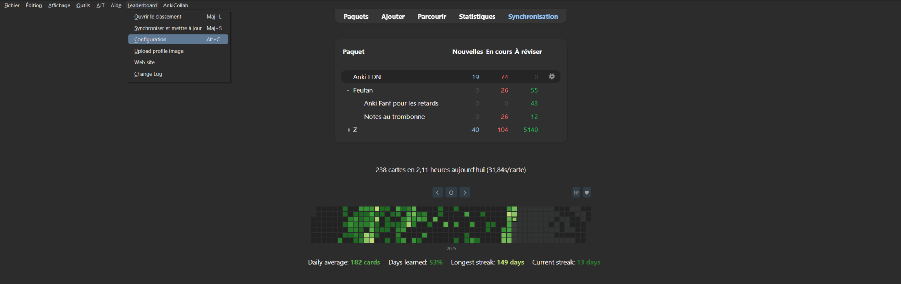

# Bonus
## Voici les outils que notre équipe vous recommande
### Add‑ons Anki 
Pour savoir comment installer un add-on, référez-vous au [tuto d'installation](./installation.md).

<h4>
  EDN Stat (inclus dans Anki EDN)
</h4>

- Permet d'afficher votre progression sur le deck Anki EDN (pourcentage d'items vus par rangs, matières, fiches LiSA).
- Accessible dans le menu `Anki EDN > EDN Stat` ou avec le raccourci <kbd>Ctrl</kbd>+<kbd>U</kbd>.

<h4>
  Pour les externes compétitifs : <a href="https://ankiweb.net/shared/info/175794613">Anki leaderboard</a> 
  <code>175794613</code>Copié
  
</h4>

- C'est un classement des utilisateurs du deck, pour se motiver mutuellement.
- Ouvrez le menu `Leaderboard > Configuration` ou faites <kbd>Alt</kbd>+<kbd>C</kbd> ;

  <figure style="width: 300px;">
      
  </figure>
- Créez votre compte dans l'onglet `Compte` (ou `Account`) ;
- **Rejoindre le groupe :**
    - Allez dans l'onglet `Groupes` (ou `Groups`) ;
    - Cherchez et rejoignez le groupe **Anki EDN**. 

      <figure style="width: 500px;">
          
      </figure>
- **Afficher le groupe :**
    - Allez dans l'onglet `Paramètres` (ou `Config`) ;
    - Dans le menu déroulant « Classement par défaut : », sélectionnez **Group** pour qu'il s'affiche par défaut à l'ouverture du classement.
      <figure style="width: 500px;">
          
      </figure>

#### Pour optimiser ses réglages : [FSRS helper](https://ankiweb.net/shared/info/759844606) et [Search Stats Extended](https://ankiweb.net/shared/info/1613056169)     <code>759844606 1613056169</code>Copié 

- Addons extrêmement complets, dont nous vous invitons à lire la documentation pour voir ce qu'ils proposent. Ici nous vous expliquerons juste comment optimiser les intervalles de mémoire courte. 
- Après avoir utilisé le deck pendant au moins quelques jours :
    - Faites le raccourci <kbd class="kbd-keyboard">Shift</kbd> + <kbd class="kbd-keyboard">T</kbd> ;
    - Descendez jusqu'à ce tableau et entrez votre rétention souhaitée ; il générera les étapes recommandées que vous modifierez dans vos options.

      <figure>
      
      </figure>
<h4>
  <a href="https://ankiweb.net/shared/info/724035414">AJT Mortician</a> 
  <code>724035414</code>Copié
  
</h4>

- Enterre automatiquement les cartes difficiles pour les revoir le lendemain. Configuration : `AJT > Mortician Options` ou <kbd>Alt</kbd>+<kbd>C</kbd>.

  <figure style="width: 400px;">
      
  </figure>

#### [FLUX Heatmap & Gamification](https://ankiweb.net/shared/info/161867424)     <code>161867424</code>    Copié

- Affiche votre assiduité sous forme de calendrier (heatmap) détaillée avec prévisions de charge et intègre un système de progression.

#### [Quick Image Search](https://ankiweb.net/shared/info/183246496)     <code>183246496</code>    Copié

- Ajoute un bouton dans l'éditeur pour lancer instantanément une recherche Google Images sur le recto de la carte pour ajouter une illustration en un clic.

#### [More Overview Stats 2.1](https://ankiweb.net/shared/info/738807903)     <code>738807903</code>    Copié

- Enrichit l'écran d'accueil d'Anki avec des statistiques détaillées sur vos paquets et estime la date de fin d'apprentissage selon votre rythme.

#### [FocusForce](https://ankiweb.net/shared/info/1356589749)     <code>1356589749</code>    Copié

- Mode anti-distraction / focus qui verrouille Anki en plein écran ou bloque les applications tierces distrayantes jusqu'à l'atteinte de votre objectif de révision.

#### [Card Info During Review](https://ankiweb.net/shared/info/2179286493)     <code>2179286493</code>    Copié

- Affiche les statistiques de la carte en temps réel pendant les révisions.

#### [Customize Keyboard Shortcuts](https://ankiweb.net/shared/info/24411424)     <code>24411424</code>    Copié

- Pour modifier tous les raccourcis clavier d'Anki.

#### [See Previous Card Ratings](https://ankiweb.net/shared/info/1906641654)     <code>1906641654</code>    Copié

- Affiche votre résultat lors de la précédente révision de la carte.

#### [Hierarchical Tags / Colorful Tags](https://ankiweb.net/shared/info/594329289)     <code>594329289</code>    Copié

- Organise et colorise vos tags de manière hiérarchique. Permet de voir les cartes suspendues en mode note.

#### [Pass/Fail](https://ankiweb.net/shared/info/876946123)     <code>876946123</code>    Copié

- Simplifie l'interface de révision en ne gardant que deux boutons (Échec / Réussite), ce qui permet de réviser plus rapidement tout en restant parfaitement compatible avec l'algorithme FSRS.

#### [Audiovisual Feedback](https://ankiweb.net/shared/info/231569866)     <code>231569866</code>    Copié

- Ajoute des retours visuels et sonores lors des réponses pour dynamiser vos sessions de révision.

#### Avance automatique native et maintien du rythme 

Dans les versions récentes d'Anki (Anki 24+ et Anki 25/26), la fonction **Avance automatique** est directement intégrée dans les options du paquet (`Options du paquet > Avance automatique`) sans nécessiter d'add-on tiers :
- Réglez les secondes avant d'afficher la réponse automatiquement (ex. 10 secondes) ;
- Choisissez l'action suivante (attendre votre réponse ou passer automatiquement).

Pour les versions antérieures ou des fonctionnalités étendues, les greffons suivants restent disponibles :
- **[Auto Reveal](https://ankiweb.net/shared/info/1010827105)** <code>1010827105</code>Copié : permet de révéler automatiquement le verso après un délai configurable.
- **[Speed Focus Mode](https://ankiweb.net/shared/info/1046608507)** <code>1046608507</code>Copié : émet une alerte sonore ou dévoile la carte si vous prenez trop de temps.
- **Alerte Fatigue EDN** (inclus dans Anki EDN) : vous prévient au bout d'un nombre défini de cartes ou de minutes consécutives pour éviter la surcharge cognitive.

### WorkFlow
#### Nos techniques pour gagner du temps sur le deck
- Optimiser régulièrement le FSRS
- Enfouir les cartes plutôt que de les réapprendre entièrement (on les verra le lendemain)
  - Quand on se spoil 
  - Quand on les confond
  - Quand on oublie un détail pas vraiment important
- Réviser avec une manette connectée à son ordinateur
  - N'importe quelle manette de console fonctionnera. Le modèle micro de 8BitDo est compact et sans fil.
  - [Addon pour configurer la manette](https://ankiweb.net/shared/info/1898790263)     <code>1898790263</code>    Copié
  - [Joytokey](https://joytokey.net/fr/) pour encore plus de personnalisation sur Windows
### IA basées sur les référentiels
- [OpenEvidence](https://www.openevidence.com) : moteur d'IA clinique gratuit pour les soignants et étudiants en médecine. Réponses médicales synthétiques, rigoureusement sourcées avec liens directs vers la littérature internationale de référence (NEJM, JAMA, The Lancet, BMJ).
- [PulseLife](https://www.pulselife.com/fr) : application clinique médicale (ex-360 medics) centralisant les recommandations de pratique clinique (HAS, sociétés savantes), la base médicamenteuse officielle (RCP, posologies, alertes ANSM/EMA), un calculateur de scores cliniques et un assistant IA médical (« PulseLife AI ») entraîné sur les sources institutionnelles.
- [EDN GTP](https://chatgpt.com/g/g-nw9p7oAPP-edn-gpt)
- [EDN AI](https://chatgpt.com/g/g-XMpoZ4ivr-edn-ai)
- [DP EDN](https://chatgpt.com/g/g-sxGvTtmZ0-dossiers-progressifs-pour-l-edn)

### Outils numériques gratuits pour les étudiants (et très pratiques!)
- Gemini et donc [NotebookLM](https://notebooklm.google.com/) gratuit pour 1 an 
- [Notion](https://www.notion.com/fr/product/notion-for-education) 

### Ressources partagées par des externes 

- Organisation des révisions
  - [Liste de Mnémotechnique participative](https://www.notion.so/2ced9253bfce80beb653ee24c4a20cbe?v=2ced9253bfce80c19fe2000c4a58e341&source=copy_link)
  - [Template Notion — Organisation EDN](https://organisationedn.notion.site/Organisation-EDN-290ec909b05380e4bbf0c31b5670a71d) <small>([source](https://www.facebook.com/groups/entraideiecn/permalink/3239762099523924/))</small>
    - Tableur classifiant les items (collège, relecture, tombabilité aux annales…).
    - Calendrier de révision avec méthode des J.
    - Graphique de progression.

- Préparation ciblée aux ECOS
  - [DocECOS](https://docecos.fr) : plateforme structurée selon les situations de départ (SDD), avec trames d'interrogatoire, grilles d'évaluation par station et débriefings vidéo.
  - [Banque Documentaire ECOS Entraide EDNi](https://shorturl.at/Atj5A) : recueil collaboratif de fiches de révision, trames d'anamnèse et grilles d'évaluation partagées entre étudiants.
  - Podcasts dédiés aux ECOS :
    - *Ecosphere* : entraînement audio aux stations de gériatrie et de prise en charge de la perte d'autonomie.
    - *ECOS ORL et CCF* : cas cliniques oraux et stations types en oto-rhino-laryngologie et chirurgie cervico-faciale.

- Collèges, polycopiés et référentiels transversaux
  - [Radiologie CERF — « Les images à connaître pour l'EDN »](https://cerf.radiologie.fr/sites/cerf.radiologie.fr/files/medias/Images%20%C3%A0%20conna%C3%AEtre%20pour%20EDN_2.pdf) : guide pratique d'iconographie et de prescription du Collège des Enseignants de Radiologie de France.
  - [Guide EFR / gaz du sang du CEP](https://cep.splf.fr/) : guide d'interprétation méthodique des EFR et gazométries pour l'EDN (Collège des Enseignants de Pneumologie).
  - [Les 172 questions tombables Pneumo](https://cep.splf.fr/wp-content/uploads/2023/07/172-QUESTIONS-DE-PNEUMOLOGIE-TOMBABLES-A-L-EDN.pdf)
  - Polycopié de Microbiologie du LISA : support de synthèse en bactériologie clinique, virologie et lecture raisonnée des antibiogrammes.
  - Polycopié de Sémiologie Cardiologique : rappels anatomocliniques, sémiologie d'auscultation et bases des tracés ECG.
  - Précis d'anesthésie cardiaque (6e édition) : référence transversale pour la physiologie cardiovasculaire appliquée, l'hémodynamique et le remplissage.
  - [Collège de réanimation — vidéos](https://www.ce-mir.fr/cemir-learning)
  - [HAS EDN](https://www.has-sante.fr/jcms/p_3076609/fr/edn)
  - [Sémio Neuro](https://www.cen-neurologie.fr/premier-cycle/semiologie-analytique/syndrome-myogene-myopathique)
  - [CNET / CNEAT](https://therap.fr/dossiers_progressifs/)

- Plateformes spécialisées et sémiologie visuelle
  - [Dermato‑ist](https://dermato-ist.fr) : atlas iconographique de référence pour la dermatologie générale, les lésions élémentaires et les infections sexuellement transmissibles.
  - [Pneumologique](https://semiologiepneumologique.com/) : fiches didactiques de sémiologie respiratoire et mécanismes physiopathologiques.
  - [DicoSemiopsy](https://dicosemiopsy.fr) : dictionnaire interactif des termes et définitions de la sémiologie psychiatrique.
  - [UNESS cardio (ECG+++)](https://cardiologie.uness.fr/portail/index.php?title=Sp%C3%A9cial:Connexion&returnto=Sp%C3%A9cial%3AListe+des+Quiz&returntoquery=emdl_id%3D523) : modules d'entraînement aux tracés électrocardiographiques et quiz interactifs.
  - [ConfCardio](https://confcardio.com) : cours et vidéos d'apprentissage méthodique de l'ECG et de rythmologie par le Dr David Bialobroda.
  - [Deranged Physiology](https://derangedphysiology.com) : ressource internationale de référence sur la physiopathologie avancée, la réanimation médicale et la ventilation mécanique.
  - [Pinky Bone](https://www.pinkybone.com/) : ressources visuelles de sémiologie et traumatologie de l'appareil locomoteur.
  - [Radiopaedia — cas cliniques](https://radiopaedia.org/search?lang=us&scope=mcqs)

- Outils d'aide à la décision clinique
  - [Antibioclic](https://antibioclic.com) : outil d'aide à la décision thérapeutique en antibiothérapie guidée par les recommandations de bonne pratique.
  - [MDCalc](https://www.mdcalc.com) : calculatrice médicale de référence pour les scores cliniques validés, équations et arbres décisionnels.
  - [Radiopep's](https://radiopeps.com) : guide d'aide à la justification et prescription de l'imagerie médicale selon les guides de la SFR/HAS.
  - [IMAIOS e-Anatomy](https://www.imaios.com/fr/e-anatomy) : atlas anatomique interactif d'imagerie médicale (coupes scanner, IRM et radiographies).
  - [LITFL ECG Library & Quiz](https://litfl.com/ecg-library/) : bibliothèque clinique internationale de tracés ECG annotés et cas cliniques d'urgence.

- Chaînes YouTube & vidéos utiles
  - [Damien Legallois — cardiologie](https://www.youtube.com/results?search_query=Damien+Legallois)
  - [Dr Synapse — physiopathologie](https://www.youtube.com/results?search_query=Dr+Synapse)
  - [Docn'roll — néphrologie](https://www.youtube.com/results?search_query=Docn%27roll+nephrologie)
  - [Linexplain — rappels thérapeutiques](https://www.youtube.com/results?search_query=Linexplain)
  - [Docteur Par Coeur — Bactéries / Antibio](https://www.youtube.com/watch?v=LJ1jJbRaTcg&list=PLz3OcroAK7ew7wc5670lHEN3W-aSXVUg-)
  - [Docteur astuce — mémotechniques](https://www.youtube.com/@DrAstuce/playlists)
  - Hémato — Hémostase :
    - [Vidéo 1 — Hémostase primaire](https://www.youtube.com/watch?v=4VhsNuK0OgY)
    - [Vidéo 2 — Coagulation](https://www.youtube.com/watch?v=SGzp9wqeu84)
  - [ECG Lyon](https://www.ecg-lyon.com/)

- Entraînement à la LCA et épreuves écrites
  - [CNEAT — Entraînement LCA](https://therap.fr/lca/) : sujets officiels d'entraînement à la Lecture Critique d'Article publiés par le Collège National des Enseignants d'Anatomie et Thérapeutique.
  - [Pr Geek (LCA)](https://www.youtube.com/c/PrGeek) : méthodologie pas-à-pas des articles scientifiques et décryptage des pièges statistiques aux épreuves de LCA.
  - [Épistémologie du raisonnement statistique — Pr Bruno Falissard](https://www.youtube.com/results?search_query=Bruno+Falissard+%C3%A9pist%C3%A9mologie+du+raisonnement+statistique) : conférence de référence sur la démarche probabiliste, la causalité et les biais méthodologiques en recherche biomédicale.
  - [TACFA — Conférences](https://tacfa.odoo.com/conf)
  - [LCA One — QCM et cours (payant)](https://www.google.com/search?q=LCA+One)

- Podcasts médicaux (révision nomade)
  - [Nephrodio](https://www.youtube.com/results?search_query=nephrodio) : podcast de référence en néphrologie, équilibre hydro-électrolytique et néphropathies glomérulaires.
  - *L'Externe* : synthèses audio de cours de DFASM enregistrées par un interne.
  - *Ligne de MIR* : retours d'expérience, physiopathologie et réflexions autour des urgences de réanimation médicale.
  - *The Curious Clinicians* : podcast d'investigation physiopathologique et clinique sur les mécanismes sous-jacents aux pathologies courantes.
  - *Didier Fassin (Collège de France)* : cycle de cours de sciences sociales, éthique médicale et santé publique. 

### Réviser avec une manette

- J'utilise [ça](https://www.8bitdo.com/micro/), mais tout ferra l'affaire (compact, c'est cool).

Pour mapper les touches de la manette aux actions Anki :
- **Sur Windows** : utilisez [JoyToKey](https://joytokey.net/en/download)
- **Sur Mac** : utilisez [Enjoy2](https://github.com/fyhuang/enjoy2/blob/master/README.md)
- **Alternative multi-plateforme** : l'add-on Anki [Gamepad](https://ankiweb.net/shared/info/1898790263)
*
### Masquer les informations de progression pour mieux se concentrer

Dans `Préférences > Révision` (<kbd>Ctrl</kbd>+<kbd>P</kbd> / <kbd>Cmd</kbd>+<kbd>,</kbd>), vous pouvez décocher :
- **« Afficher le nombre de cartes restantes »** — pour ne plus voir le compteur de cartes pendant les révisions
- **« Afficher la date de la prochaine révision au dessus des boutons »** — pour ne pas être distrait par les intervalles futurs
